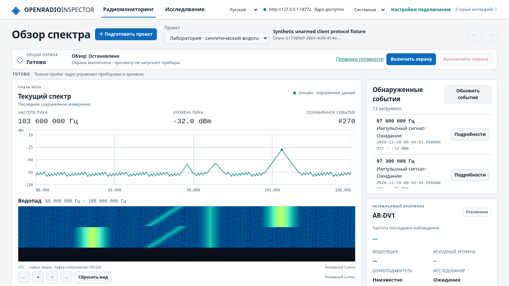

# OpenRadioInspector

OpenRadioInspector записывает радиочастотные панорамы, сравнивает их с локальным эталоном и помогает исследовать изменения эфира. tinySA Ultra ведёт обзор. AOR AR-DV1 независимо настраивается на выбранную частоту. Оператор может перейти от события к исходной панораме и наблюдению приёмника.



*Работающий WebUI с учебным архивом 88–108 МГц. Каждая строка водопада соответствует сохранённому свипу.*

## Установка

Для версии 0.4.0 доступны инженерные сборки. Публичный стабильный выпуск ожидает подписания и аппаратной приёмки. На странице состояния приведены проверенные пакеты, их контрольные суммы и результаты для каждого стенда. [Сборки и результаты](docs/release/status.md)

| Платформа | Рабочее место | Первый запуск |
|---|---|---|
| Raspberry Pi 5, 8 ГБ, SSD, Raspberry Pi OS 64-bit | Debian-пакет с ядром и WebUI | Откройте на Pi `http://127.0.0.1:8770/modern/`. [Установка на Pi](docs/pi-rc1.md) |
| Windows 11 x64 | Установщик NSIS с Tauri и WebView2 | Выберите локальный узел или подключитесь к сопряжённому удалённому ядру. [Установка на Windows](docs/windows-standalone-rc.md) |
| Mac с Apple Silicon | DMG с нативным SwiftUI-приложением и пользовательской службой | Откройте настройки приборов и подключения и запустите службу. [Первое подключение на Mac](docs/macos-observation-console.md) |

## Работа с измерениями

В WebUI и Windows основные экраны называются «Радиомониторинг» и «Исследование». На Mac им соответствуют «Наблюдение» и «Архив».

1. В **«Радиомониторинге»** выберите проект, приборы и диапазон. Проверьте приёмный тракт, доступное место и фактический период обзора. Для подтверждения эталона требуется минимум 20 совместимых полных свипов за интервал от 60 секунд.
2. Включите охрану. Панорама и водопад показывают поступающие измерения. В карточке отклонения видны частота, время и ссылка на исходник. Границы обзора и возраст каждого окна помогают заметить разрывы покрытия.
3. В **«Исследовании»** откройте исторический свип и сопоставьте его с наблюдением AR-DV1 по частоте и времени. tinySA измеряет уровень в dBm, S-метр AR-DV1 возвращает исходные отсчёты. Переключение рабочего пространства сохраняет состояние охраны.

Русское руководство с девятью снимками входит в инженерные пакеты. Оно объясняет подготовку, постановку на охрану и поиск исходного измерения. [Руководство оператора](docs/operator-guide/index.html) · [Скачать руководство для просмотра офлайн](https://github.com/qlolp/openradioinspector/actions/runs/44658835421/artifacts/14593729602)

## Запуск из исходников

Для знакомства с данными подойдёт входящий в репозиторий Python CLI. В окружении Python 3.10 или новее выполните эти команды из корня проекта.

```sh
python -m pip install -e .
python -m radioinspector demo --output ./demo-data --cycles 60
```

Команда напечатает путь созданной базы панорам. Передайте его параметру `--database` команды `python -m radioinspector serve` и откройте `http://127.0.0.1:8770/`. Список команд обработки и экспорта доступен через `python -m radioinspector --help`. [Примеры работы с архивом из CLI](docs/python-cli.md)

| Для разработки | Где начать |
|---|---|
| Служба Rust, клиенты и владение приборами | [Архитектура платформы](docs/platform-architecture.md) |
| HTTP API, SSE, контракты и SDK | [API v1](docs/api-v1.md) · [Контракты](contracts/) |
| Хранение исходников, дисковый бюджет и восстановление | [Схемы архива](docs/compact-panorama-events.md) · [Резервное копирование](docs/rust-core-backup.md) |
| Методы измерения и единицы | [Методики](docs/measurement-methods.md) · [Калибровка поля](docs/field-strength-rms-v2.md) |
| Запуск тестов и аппаратная приёмка | [Проверки из исходников](docs/release-validation.md) · [План 0.4.0](docs/release/0.4.0.md) |
| Навигация по документации | [Установка, приборы, исследования и разработка](docs/README.md) |

Собственный код проекта распространяется по [лицензии MIT](LICENSE). Для сторонних компонентов и материалов действуют условия их правообладателей. [Происхождение и лицензии](docs/release/provenance.md)

Точность зависит от прибора, антенны и калибровки тракта. Для нормативных измерений требуется аттестованный измерительный комплекс.
