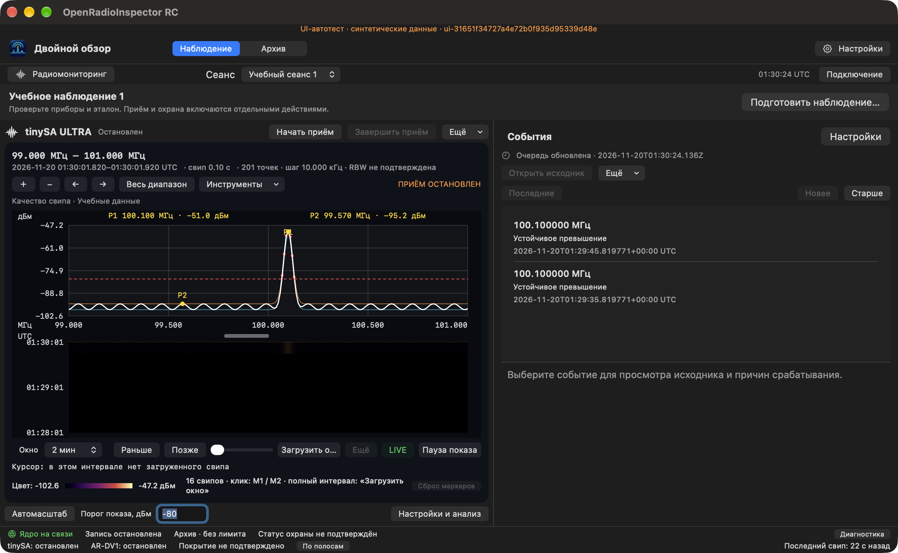
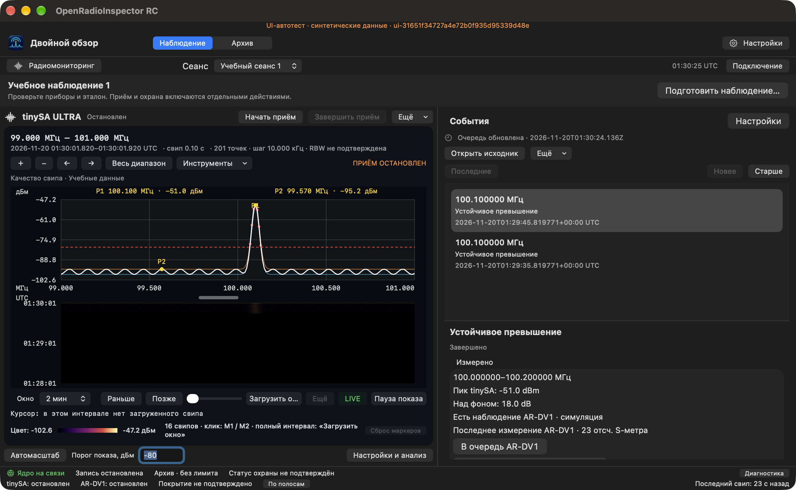

# Пульт наблюдения macOS

Новый основной маршрут предназначен для технического пользователя, который
ещё не знаком с программой: подготовка → наблюдение → событие → исходник →
очередь AR-DV1 → решение оператора. Это реализация интерфейса; установленный
пакет, производительность и аппаратный контур принимаются отдельно.

Справочник в установленном приложении открывается по пути `/Applications/OpenRadioInspector RC.app/Contents/Resources/operator-guide/index.html`. [Офлайн-руководство с иллюстрациями](operator-guide/index.html)

## Начало работы

1. Откройте «Настройки → Приборы и подключение», проверьте службу и подключение.
   Открытие настроек не подключает USB автоматически.
2. В «Наблюдении» выберите «Подготовить наблюдение…». Мастер содержит четыре
   раздела: проект/приборы; тракт/подключение; эталон; готовность/охрана.
3. Введите два разных порта, диапазон в **МГц** и RBW. Допускаются точка или
   запятая и до шести дробных знаков. Экспонента и разделители тысяч не принимаются.
   В ядро передаются целые Гц; исходные измерения не пересчитываются.
4. Подтвердите тракт и расположение, затем явно запустите подключение и сбор.
   Для каждого диапазона нужны одновременно ≥60 секунд и ≥20 полных совместимых
   свипов. Время и количество показаны независимо.
5. Подтвердите пригодность эталона и резерв копии. После проверки бюджета
   (8 часов +50%, резерв backup и служебное место) включите охрану отдельной кнопкой.

Открытие мастера, переход к следующему разделу и закрытие настроек сами по себе
не включают охрану. Причины недоступности действий показаны рядом с ними.
«Снять с охраны», «Завершить приём» и остановка службы — разные операции.

## Наблюдение и разбор

Слева — спектр и водопад, справа — постраничные события и карточка выбранного
события. Подробные настройки приёма доступны через «Настройки и анализ» под
графиком; 3D, эталон и дополнительные действия — в меню «Инструменты».

На MacBook Air с macOS 27.3 установлена инженерная сборка `0.4.0-macos.rc.1` с локальной подписью ad hoc. Зелёная кнопка **LIVE** под водопадом возвращает просмотр к последним данным и снимает паузу показа. На снимке пульт хранит 16 учебных свипов. Над спектром показано «ПРИЁМ ОСТАНОВЛЕН», внизу — «Запись остановлена», последнему свипу 22 секунды. Измерения запускает «Начать приём». После запуска проверьте новые UTC и состояние «Запись идёт».

Строка состояния разделяет ядро, оба прибора, охрану, архив и покрытие.
Потеря связи или неподтверждённый статус проекта не показываются как успешная
охрана. Возраст свипа относится к приёму, а не к положению курсора.

- Выберите событие. Отметка непросмотра снимается после успешного получения
  его карточки; ошибка загрузки оставляет событие непросмотренным.
- «Открыть исходник» выводит точный свип действующего потока на основной график
  с подписью «ИСТОРИЯ». Для другого запуска/потока открывается отдельный read-only
  просмотр с исходными ID и UTC; действующий сеанс не переключается.
  Исходник не заменяется текущим пиком. Пауза и архив меняют только показ.
- В карточке отдельно представлены измерения, справка/гипотезы и решение
  оператора. Справочная полоса частот не является идентификацией сигнала.
- «В очередь AR-DV1» использует максимум **исходного свипа внутри полосы события**.
  Нужны приёмник и исходник текущего сеанса/потока. Кандидат сохраняет исходные
  UTC, уровень, единицу и ссылку на свип. Команда не запускает исследование.
- «Очередь и управление AR-DV1…» открывает действующую очередь: запуск требует
  отдельного действия. Подтверждение очереди не означает подтверждённый приём.
  Исходные отсчёты AR-DV1 остаются `s_meter_count`.
- При неизвестном результате POST повторная отправка блокируется: проверьте
  кандидатов и очередь. Потеря ответа не доказывает отсутствие команды в ядре.
  Журнал этого окна ограничен 128 командами и не вытесняет неизвестные результаты;
  при заполнении новые команды блокируются с объяснением.
- Сохраните решение и комментарий. Это изменяет запись решения, сохраняя исходные
  измерения. Периодическое обновление карточки не перезаписывает черновик текста.

Когда выбрано событие, прочитайте измерения справа. В этом учебном архиве пик tinySA равен −51,0 дБм, превышение над фоном — 18,0 дБ, приёмник AR-DV1 вернул 23 отсчёта S-метра. Нажмите «Открыть исходник» над очередью для сверки исходного свипа.

Новые события не перехватывают выбранную строку. Навигация сохраняет подключение
и фоновый опрос; скрытый график не выполняет работу рендеринга. При возврате
сохраняются масштаб, маркеры и зафиксированный просмотр. Смена источника отделена
точными идентификаторами сервера, проекта, сеанса и потока.

## Архив и клавиатура

Архив содержит поиск по UTC/частоте, страницы, открытие оригинала и прежние
средства экспорта/хранения. Открытие исходника возвращает на пульт. При отключённом
приборе архив доступен через работающую службу.

| Команда | Клавиши |
|---|---|
| Пульт наблюдения | Command-1 |
| Архив | Command-2 |
| Настройки наблюдения | Command-, |
| Открыть подготовку | Command-Shift-N |
| Закрыть диалог | Escape |

Команды адресуются активному окну; горячих клавиш включения охраны и перестройки
приборов нет. Для кнопок и полей предусмотрены accessibility-наименования.

## Макет и приёмка

[Интерактивный макет](ui/macos-observation-console.html) работает без сети и
приборов. Все данные в нём синтетические; он не является клиентом API и не
служит доказательством проверки установленного приложения.

Перед приёмкой: проверить 1000×700, 1200×792 и 1440×900, светлую/тёмную темы,
увеличенный текст, контраст, Tab/Shift-Tab/Space/Enter/Escape и VoiceOver.
Три новых технических пользователя проходят основной маршрут без подсказок;
для каждого фиксируются время, ошибки, непонятные подписи и необходимость помощи.
Обязательны отсутствие критических ошибочных действий и правильное объяснение
разницы между приёмом, охраной и паузой показа. Неуспех исправляется до итогового
повтора. Сырые журналы и сведения участников остаются приватными.

Полная приёмка пакета: [канонический протокол](release/macos-post-test-comprehensive-acceptance.md).
Пороги, исходные количества, сроки и проверки cleanup не ослабляются.
