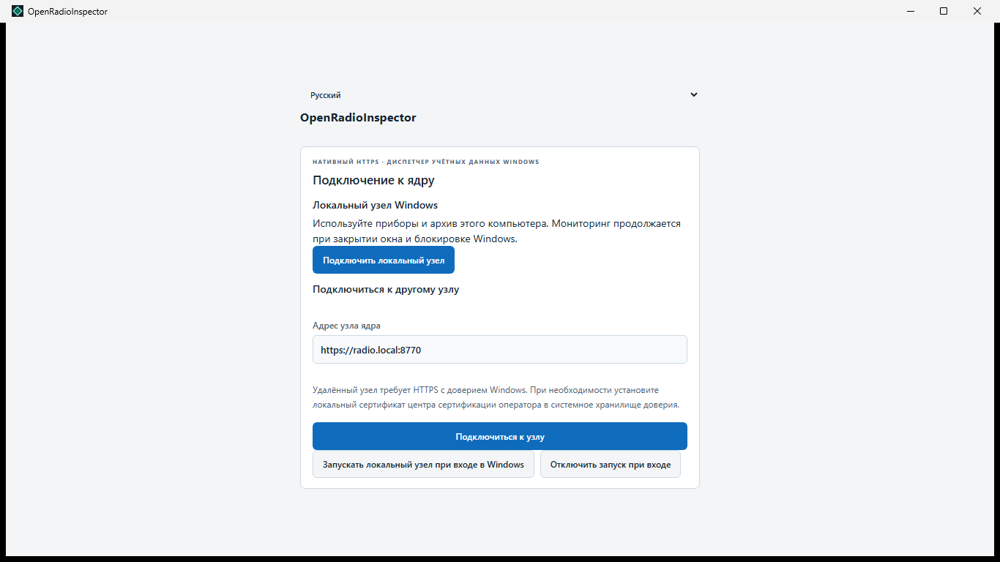
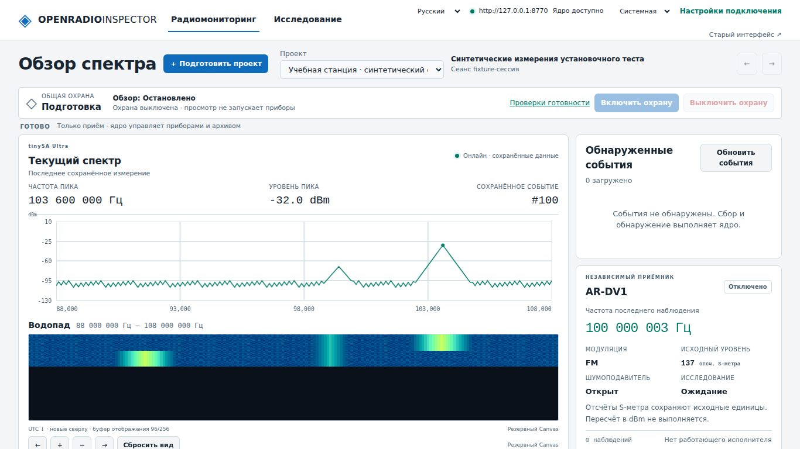

# Рабочее место оператора Raspberry Pi и Windows

Браузер на Pi и Windows-клиент Tauri загружают общий интерфейс. Измерения, проект, состояние охраны и архив принадлежат выбранному ядру. Выбор проекта, вкладки, языка и системной, светлой или тёмной темы хранится на клиенте. Переключение между «Радиомониторингом» и «Исследованием» доступно через Alt+M и Alt+R.

[Руководство с иллюстрациями](operator-guide/index.html) открывается без подключения к сети. В пакете Pi оно лежит в `/usr/share/doc/openradioinspector-pi-rc/operator-guide/index.html`, в Windows — в `runtime\operator-guide\index.html` внутри установленного приложения.

## Подготовка

1. В Windows выберите локальный узел либо адрес Pi. Для удалённого соединения используется доверенный HTTPS и существующее сопряжение. Браузер Pi работает с ядром, которое отдало страницу. В окне отображается источник соединения.
2. Выберите проект или нажмите «Подготовить проект». Задайте отдельные последовательные порты, антенну и место. Симуляторы выбираются явно. На ядре с поддержкой RX readback можно запросить подтверждение настройки AR-DV1 с прошивкой VR2504A. Исполнитель проверяет подключённый прибор при запуске.
3. «Проверки готовности» ведут к проверкам приборов, архива и фоновой обстановки. На ядре с поддержкой планов сохраните нужные полосы. Для сетки 10 кГц можно заполнить границы 100 000 и 1 300 000 000 Гц одной кнопкой. Сетка содержит 129 991 точку с учётом обеих границ. RBW 30 кГц и 10 кГц выбираются отдельно. Срок возврата задаёт оператор. Фактическое время появления следующего измерения показывает ядро.
4. Начните сбор обычной обстановки, просмотрите прогресс окон и подтвердите эталон каждого поддиапазона. Включение охраны требует готовности ядра и подтверждённых эталонов.



На первом запуске Windows нажмите «Подключить локальный узел» для работы с приборами этого ПК. На снимке инженерная версия `0.4.0-rc.1` с виртуальной Windows x64, сборка 26100. Установщик имел статус Authenticode `NotSigned`. Проверка этого окна остановилась на задании адреса учебного ядра.

## Панорама, водопад и очередь



На виртуальной машине ARM64 с Ubuntu 24.04.5 Chromium открыл установленный Debian-пакет для Pi версии `0.4.0-1`. В режиме подготовки сохранены 96 синтетических свипов. Показан исходник `pi-guide-synthetic-095`. Такой пульт на физической Pi открывают по пути `/modern/` в Chromium на самой плате.

Для плана с частотной сеткой верхняя панорама хранит пиковые значения последнего полного измерения каждого принятого этим клиентом аппаратного окна независимо от водопада. На поддиапазон приходится до 4096 значений. Новый проход заменяет пики предыдущего, включая уменьшившиеся уровни. Проверьте номер окна, время, давность и исходную запись через «Просмотреть окно панорамы». По каждой колонке выбирается максимальный уровень. Пустые колонки обозначают частоты, для которых клиент ещё не получал отсчётов в этом сеансе и версии плана. Водопад сразу под панорамой сохраняет общую ось поддиапазона. Ниже показан настраиваемый спектр последнего окна с его границами, пиком и исходным идентификатором. Он хранит до 256 строк для текущего потока. Исходные свипы доступны в архиве.

Строка «Проверка поддиапазона» передаёт заключение ядра по измерительному профилю. Для последнего окна указано его собственное заключение. Статусы различают поддерживаемый диапазон, частичную проверку, отсутствие проверки и учебные данные. При переходе за подтверждённую границу интерфейс показывает её частоту и требование измерить опорный сигнал выше 800 МГц. Карточка оригинала показывает квалификацию, которую ядро вернуло для этого конкретного свипа. В предпроверке готовность считается по допущенным к автоматическому эталону окнам. Число исключённых окон отображается отдельно. Для старого ядра или архива выводится «Ядро не сообщило результат».

Число измеренных окон, число полных проходов, давность и время возврата поступают от исполнителя. Для поиска частоты в старом измерении используйте «Исследование», UTC-фильтры и исходную панораму. Ручное управление и возврат анализатора выполняются отдельными командами.

В очереди «Подробности» открывают событие. Здесь доступны привязанное наблюдение AR-DV1, его UTC, частота, режим, исходный отсчёт S-метра и идентификатор. Раскрытие исходного наблюдения показывает его полный JSON. «Исходный спектр» вторым действием открывает панораму и таблицу точек, а также выгрузку оригинала. Esc возвращает фокус к предыдущему элементу. Отсутствующий источник отмечается в карточке события.

## Проверка парных измерений

В «Подробностях события» совместимое ядро возвращает сохранённую проверку. На экране «Исследование» откройте «Сравнение парных измерений», выберите событие и загрузите список исходных ссылок JSON до 64 КиБ. Каждый элемент содержит `sweep_id` и 1–32 различных `observation_ids`. Нужны исходная пара, 10–22 соседние точки по обе стороны частоты, две контрольные точки в ±100 кГц и один или два повтора. Уровни и пороги рассчитывает ядро по архиву. Для каждого повторного посещения доступны измеренные разности, идентификаторы и независимые заключения «Сигнал повторился» и «Расхождение повторилось». Отсутствующий результат и ошибка чтения имеют отдельные состояния.

## Состояние и восстановление

Панель узла показывает среднюю скорость записи свипов активного исполнителя от его запуска до последнего сохранённого измерения. Очередь записи учитывает уже принятые операции, включая выполняемую. При наличии данных ядро сообщает свободное место, средний размер сохранённого исходного свипа, прогноз записи за сутки, резерв для копии, журнал предзаписи и время хранения. Прогноз включает запас ядра и может отличаться от физического прироста архива. Показатели старого ядра без таких данных помечаются как недоступные. Данные архива обновляются при выборе проекта, затем каждые 30 секунд и по команде оператора.

Сообщение о проблеме USB указывает затронутый прибор и ошибку исполнителя. Проверьте кабель, порт и доступ на узле. При ошибке архива проверьте свободное место, лимит и право записи. Кнопка «Проверить состояние» перечитывает состояние и готовность. При ручном управлении анализатором широкий обзор восстанавливается через возврат прибора в «Исследовании».

## Сегмент AR-DV1

На ядре, которое поддерживает аппаратный проход по сегменту, для проекта с последовательным AR-DV1 в «Исследовании» появляется отдельная форма. Задайте границы, шаг в Гц и время установления. Поддерживаются 2–1000 точек FM на сетке настройки 10 Гц. Подготовка сохраняет отдельный сеанс с одним приёмником. Команда старта занимает его порт. Сбор и охрана проекта используют этот же порт, поэтому кнопка старта ждёт их завершения.

Сеанс выполняет один проход. Исполнитель освобождает порт после последней точки. Штатная ранняя остановка сохраняет уже начатую точку. «Завершить сеанс сегмента» завершает запись жизненного цикла после выхода исполнителя. Статус, число сохранённых точек и последнее наблюдение перечитываются из ядра при повторном открытии. Для синтетического проекта эта аппаратная команда недоступна.

## Проверка без приборов

Из каталога `clients/web` под Node 26 выполняются `npm run build`, `npm run build:native`, `npm test` и `npm run test:e2e`. Команда `npm run test:station` отдельно проверяет готовую производственную сборку через Vite Preview. Сценарии `e2e/station.spec.ts` используют локальное синтетическое ядро и явно заданные ответы для аппаратных возможностей. Размеры CSS-области и коэффициенты плотности воспроизводят 1366×768 и 1920×1080 при масштабе 125–200%. Сценарий водопада записывает в тестовый архив 192 свипа с изменением частоты пика, проверяет цвета видимых строк на снимке 1366×768 и сохраняет снимок в результатах Playwright. Проверка реального встроенного WebView2, экрана Pi и приборов требует стенда.

## Снимки рабочего места

Иллюстрации общей веб-сборки получены из `clients/web/dist` в Chromium 156 на Debian 13 x86-64 с локальным HTTP-ядром, временной SQLite-базой и учебными источниками. Сценарии `e2e/station.spec.ts` записывают измерения через API и проходят по кнопкам интерфейса. Команды выполняются в `clients/web` под Node 26.

```sh
npm run build
npx playwright test --config playwright.station.config.ts -g 'two distinct committed|captures an archived|running synthetic guard'
```

В выходном каталоге Playwright появятся `monitoring-multirow-1366.png`, `web-linux-event.png`, `web-linux-research.png` и `web-linux-guard.png`. Для публикации используйте отдельный учебный проект, открытый исходник и кадр с подтверждённым ID свипа. Сохраняйте SHA-256 каждого файла, SHA пакета или собранного frontend, систему, графическую среду, размер и источник измерений. Полный перечень текущих кадров приведён в [атрибуции иллюстраций](operator-guide/captures.json).

Для кадра физического пульта откройте `/modern/` в Chromium на самой Pi. Для Windows откройте установленный Tauri/WebView2 и подключите его к локальному учебному ядру. На Mac откройте нативный «Пульт наблюдения» в установленном приложении с отдельным учебным архивом. Захватывайте только окно работающего приложения и проверьте, что в нём видны выбранный учебный проект и данные. Протокол установки каждого пакета хранит фактический SHA, сборку ОС и параметры захвата.
