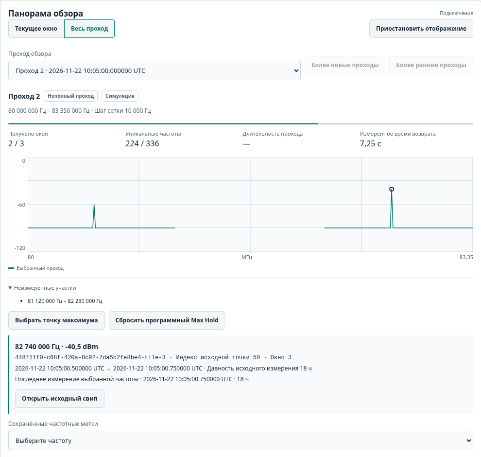

# Спектр RF Explorer 3G Combo

Rust-ядро читает спектр **RF Explorer 3G Combo серии Standard** с основной платой WSUB1G, расширением WSUB3G и прошивкой 1.34. Идентификация использует ответ анализатора `#C2-M:003,005,01.34`. USB-мост Silicon Labs CP2102 указывает порт подключения. Такой мост также встречается в других приборах.

| Активный вход | Диапазон |
|---|---|
| Левый SMA, WSUB1G | 240–960 МГц |
| Правый SMA, WSUB3G | 15–2700 МГц |

Подключите антенну к выбранному на приборе входу. Ядро считывает активную плату, её допустимые частоты и ширину обзора. По состоянию на 21 ноября 2026 года последняя опубликованная производителем прошивка для этой серии — **1.34**. В строке идентификации прибор выводит её как `01.34`. [Спецификация 3G Combo](https://j3.rf-explorer.com/rf-explorer-3g-combo-specification.html) · [Прошивка серии Standard](https://version.rf-explorer.com/docs/RF%20Explorer%20Spectrum%20Analyzer%20Firmware%20Release%20Notes.pdf)

## Начать приём

1. Подключите RF Explorer по USB к компьютеру, на котором запущено ядро. На приборе включите режим спектроанализатора и скорость USB 500 000 бод. Закройте другую программу, если она занимает тот же порт.
2. На Mac откройте **Подключение**. В сборке с локальным ядром нажмите **Локальное ядро на этом Mac → Запустить локальное ядро**. Если рядом с адресом отображается **Нет подключения**, нажмите **Подключить**. Рядом со статусом ядра нажмите **Подключить приборы…** и выберите **RF Explorer 3G Combo** и его порт. В WebUI или Windows для этого откройте вкладку **RF Explorer**. Ядро с включённым последовательным транспортом сообщает `features.rf_explorer_3g_spectrum = true`.
3. Выберите **Автообзор 10 кГц** для широкой полосы или **Окно прибора** для непрерывного наблюдения одного участка. Чтобы настроить одно окно с шагом 10 кГц, выберите **Задать окно** и введите, например, **100,000–101,110 МГц**. В нём 112 точек и 111 промежутков. Ядро сверяет обе границы с ответом прибора.
4. Начните приём. Спектр показывает последнее сохранённое окно, водопад — последовательность окон. В архиве выберите тот же сеанс и поток для просмотра исходных уровней. Остановка потока освобождает его порт.

## Автоматический обзор с шагом 10 кГц

- **Mac.** В форме подключения выберите **RF Explorer 3G Combo → Автообзор 10 кГц → Весь активный вход**, укажите USB-порт и нажмите **Начать автообзор 10 кГц**. Для полосы **100–400 МГц** выберите **Свои границы**, введите **100** и **400**, затем начните обзор той же кнопкой.
- **WebUI и Windows.** На вкладке **RF Explorer** откройте **Новый сеанс измерения спектра → Режим измерения**. Выберите **Обзор с шагом 10 кГц · весь диапазон активного модуля** или **Обзор с шагом 10 кГц · выбранный диапазон**. Единицы указаны рядом с полями. После создания и запуска сеанса включите его поток.

В одном сеансе ядро автоматически перестраивает прибор, сохраняет каждое окно и после последнего начинает следующий проход. В заголовке видны общий диапазон и номер текущего окна. На Mac кнопка **Завершить приём** останавливает поток и освобождает прибор.

Ядро узнаёт доступный диапазон из ответа активного входа. На проверенном 3G Combo Standard правый SMA (WSUB3G) сообщает **15–2700 МГц**, левый WSUB1G имеет пределы **240–960 МГц**. Антенну подключают к соответствующему SMA. Для режима 112 точек первый и последний отсчёты отдельного окна разделяет **1,110 МГц**. Следующее окно начинается через 1,120 МГц от начала предыдущего. Последнее окно сдвигается к верхней границе. В архив попадают все его реальные отсчёты, включая перекрытие.

| Запрошенная полоса | Уникальных частот с шагом 10 кГц | Окон за полный проход |
|---|---:|---:|
| 100–120 МГц | 2 001 | 18 |
| 80–120 МГц | 4 001 | 36 |
| 100–400 МГц | 30 001 | 268 |
| 15–2700 МГц | 268 501 | 2 398 |

Для произвольной полосы укажите границы, кратные 1 кГц, с разностью, кратной 10 кГц, и шириной от 1,110 МГц. Ядро держит один USB-порт, после каждой перестройки проверяет возвращённую конфигурацию и сохраняет исходный свип с UTC-интервалом, ID, режимом детектора и RBW. Заголовок текущего окна показывает позицию в проходе. После повторного запуска начинается проход с новым идентификатором.

Окна снимаются последовательно. Если короткая передача началась и закончилась, пока прибор работал в другой части диапазона, она может быть пропущена. Для оценки времени возврата сравните время начала одного и того же окна в двух проходах. Полоса 100–400 МГц требует примерно в девять раз меньше перестроек, чем 15–2700 МГц. [Руководство производителя](https://version.rf-explorer.com/docs/RF%20Explorer%20Spectrum%20Analyzer%20User%20Manual.pdf#page=14)

**Проверка на MacBook Air, 23 ноября 2026 года.** RF Explorer 3G Combo Standard с прошивкой 1.34 подтвердил правый вход WSUB3G, шаг 10 кГц, RBW 15 кГц и аппаратный Max Hold. С каждого из двух диапазонов записано по два полных прохода. Время измерено по UTC-интервалам приёма кадров на этом Mac.

| Полоса | Длительность первого и второго проходов | Возврат к первому окну | Повторно измерено частот в каждом проходе |
|---|---|---|---:|
| 100–400 МГц | 58,405 и 58,769 с | 58,417 с | 15 |
| 15–2700 МГц | 515,101 и 515,118 с | 515,114 с | 75 |

На отдельной копии этих записей архивный интерфейс сверили с экспортом CSV и NDJSON. Для четырёх проходов при ширине 512 и 2 048 колонок совпали частоты, уровни, исходные свипы и время всех 10 240 отображённых пиков. Также совпали программные максимумы по двум проходам и ссылки на все 5 332 исходных окна. Сверка 240 запросов маркеров охватила все перекрытия, пропуски, сброс удержания и 12 частот, на которых соседний пик оказался выше при обеих ширинах графика.

Измеренные периоды относятся к этому стенду и настройкам. Для наблюдения быстрых изменений на выбранной частоте используйте одно окно и проверьте режим детектора на приборе.

### Живая панорама и история

В отдельном сеансе RF Explorer выберите **Весь проход**. График пополняется по мере записи окон в архив. **Текущее окно** показывает последний отдельный свип. Счётчики окон и уникальных частот помогают различить почти законченный и полный проход. Например, последние два окна полосы 100–400 МГц содержат 15 общих частот. В архиве остаются оба измерения каждой из них.

На графике видны только измеренные участки. Каждая колонка экрана показывает самую сильную из попавших в неё точек. При равных уровнях используется более раннее измерение, затем первый индекс отсчёта. Выберите пик, чтобы открыть исходное окно с частотой, уровнем, номером отсчёта и UTC-интервалом. Возраст указывает, когда прибор в последний раз измерил эту частоту. Время исходного максимума видно отдельно.

В **Текущем окне** WebUI и Windows время последнего измерения выбранной частоты обновляется при поступлении нового отсчёта на этой частоте. Оно остаётся на экране и после того, как прежнее окно покинет водопад.



На этом снимке WebUI открыта учебная запись. Из трёх окон получены два, а у выбранного пика 82,740 МГц видны исходный свип, индекс точки и время. Кнопка **Открыть исходный свип** показывает отдельное окно.

После полного прохода появляется его длительность. Фактическое время возврата вычисляется по началу одного и того же окна в двух соседних совместимых проходах. При смене входа, сетки, RBW, детектора или поправки амплитуды начинается отдельное сравнение. При повторном подключении окно принадлежит новому запуску.

**Программный Max Hold** удерживает максимумы архивных наблюдений после сброса. У каждого клиента своё время сброса. Время и ID исходника помогают понять, в каком проходе появился пик. При аппаратном детекторе **Max Hold** уже сам прибор возвращает удержанные уровни. Такой режим обозначается в сведениях о проходе.

В истории выберите проход и откройте окно. Стрелки переходят между сохранёнными окнами. Воспроизведение использует интервалы оригиналов. Пауза действует только на просмотр. Именованный набор из одной–четырёх частот сохраняется в сеансе и доступен другим клиентам с правом чтения. Сохранение и выбор маркеров не перестраивают прибор.

В WebUI и Windows можно заполнять набор во время автообзора. При переходе к следующему проходу введённые название и частоты остаются в форме. Если вы выбрали сохранённый маркер, его частота остаётся выбранной, и после измерения этой частоты можно открыть исходное окно нового прохода.

### Выбор диапазона

Выберите **80–120 МГц**, **100–400 МГц**, весь активный вход или укажите свои границы. Режим **Центр / Полоса** задаёт ту же сетку, что и **Начало / Конец**. Перед запуском сверьте вход SMA и количество окон. Оба первых пресета требуют правого входа WSUB3G. Полный диапазон левого входа составляет 240–960 МГц, правого — 15–2700 МГц. До первой связи с прибором интерфейс может показать только ожидаемые ограничения. Перестройка начинается после явного запуска приёма и проверки активного входа.

### Исследование исходного окна

Откройте исходный свип из панорамы. Если на ядре включён научный обработчик и у вас есть права оператора, доступны две операции.

- **Допуск к эталону.** Выберите свип сравнения из того же потока, задайте отдельно верхнее и нижнее отклонения в дБ. Результат показывает точки выше, ниже и внутри допуска. Частоты без измерения в эталоне отмечены как пропуски.
- **Мощность в полосе.** Выберите две частоты одного окна, записанного в режиме Normal. Результат в дБм рассчитан по исходным уровням и указанной прибором RBW. Это оценка с некалиброванной эквивалентной шумовой полосой фильтра. Свипы данного стендового прогона записаны с аппаратным Max Hold. Для оценки мощности потребуется запись в Normal. [Методика и условия применимости](spectral-mask-analysis.md)

### Просмотр полевых записей на Android

В приложении выберите **Архив → Открыть .orifield…** или укажите завершённый сеанс телефона. Выберите поток, откройте **Трек GPS**, введите частоту в МГц и нажмите **Применить**. Цвет точки показывает уровень связанного измерения в этом месте. Касание открывает исходный свип или наблюдение. Для RF Explorer и tinySA доступны дБм, для AR-DV1 — исходные отсчёты S-метра. [Офлайн-архив и обозначения карты](field-archive.md#reviewing-levels-along-a-route-on-android)

### Панорама завершённого прохода

Архив хранит все отдельные окна. Из каталога исходников можно получить CSV полной сетки и SVG с пиками. В командах ниже `CORE_URL` — адрес ядра из интерфейса, `SESSION_ID` и `STREAM_ID` — идентификаторы сеанса и потока. `PASS_ID` берётся из `settings.survey.pass_id` сохранённого свипа. На Mac он также доступен в подсказке номера окна.

```sh
python3 -m radioinspector.archive_export_stream --server "$CORE_URL" \
  --session "$SESSION_ID" --stream-id "$STREAM_ID" --output session.ndjson
python3 tools/rf_explorer/export_survey.py --input session.ndjson \
  --pass-id "$PASS_ID" --csv panorama.csv --svg panorama.svg
```

Экспорт проверяет каждое окно и шаг до публикации графика. В CSV каждой частоте соответствует одна строка с уровнем, ID свипа, номером отсчёта и интервалом UTC. У повторно измеренных частот в этой строке есть обе записи. В полном проходе правого входа таких частот 75. SVG сохраняет максимумы при уменьшении числа точек до ширины графика. В отчёт входят время от первого до последнего окна и промежутки между ними.

### Как читать измерение

Частота точки равна началу принятого окна плюс номер точки, умноженный на шаг, который сообщил RF Explorer. Полоса измерительного фильтра (RBW) записывается отдельно. В проверенном окне с шагом **10 кГц** прибор сообщил **RBW 15 кГц**. Близкие несущие могут попасть в полосу одного фильтра.

Режим **Max Hold** показывает удержанные максимумы. Для наблюдения уровня в реальном времени на приборе выберите **Normal**. Исходные уровни, режим детектора, активная плата, RBW и поправка амплитуды сохраняются вместе. Для цифрового отсчёта `b` и указанного прибором смещения `offset_db` уровень в дБм равен `offset_db − b / 2`. Каждый исходный байт можно точно восстановить из записанного уровня и смещения. Время кадра относится к приёму данных ядром. Сеанс RF Explorer работает независимо от охранного проекта tinySA и AR-DV1.

## Параметры сеанса API v1

В `POST /api/v1/sessions` передайте описание сеанса, указав локальный порт компьютера ядра. Ниже приведён пример для macOS.

```json
{
  "name": "Спектр RF Explorer",
  "streams": [{
    "device": "RF Explorer 3G Combo",
    "role": "spectrum_analyzer",
    "level_unit": "dBm",
    "port": "/dev/cu.usbserial-EXAMPLE",
    "settings": {
      "adapter": "rf-explorer-3g-serial",
      "baud": 500000,
      "start_hz": 100000000,
      "stop_hz": 101110000
    }
  }]
}
```

Чтобы сохранить текущую настройку RF Explorer, опустите оба поля частоты. Используйте возвращённые идентификаторы сеанса и потока. Последовательно отправьте `POST /api/v1/sessions/{id}/start` и `POST /api/v1/sessions/{id}/streams/{stream_id}/start` с телом `{}`. Проверьте состояние через `GET /api/v1/sessions/{id}/workers`. Оригиналы доступны в `GET /api/v1/sessions/{id}/sweeps?stream_id={stream_id}` и через события `sweep.received`.

Для завершения отправьте `POST /api/v1/sessions/{id}/streams/{stream_id}/stop` с телом `{}`. Предыдущие свипы остаются в архиве. [Жизненный цикл и архивные маршруты](api-v1.md#жизненный-цикл)

Для автоматического обзора требуется `features.rf_explorer_10khz_survey`. Передайте `"survey_step_hz": 10000` в `settings` потока. Обе границы можно опустить, чтобы пройти весь активный вход. В каждом сохранённом окне `settings.survey` содержит границы общей сетки в герцах, `step_hz`, номер прохода `pass`, номер окна `tile`, число окон `tiles` и `pass_id`. Нумерация начинается с единицы. Сохранённые точки относятся к фактическому окну из измерительного ответа. Полноту прохода проверяют по всем его окнам и отсчётам.


### Чтение панорамы через API

Флаг `features.rf_explorer_survey_panorama` сообщает, что ядро умеет читать сохранённые проходы. Для просмотра архива достаточно учётных данных с правом чтения.

| GET относительно `/api/v1/sessions/{id}/streams/{stream_id}/rf-explorer` | Результат |
|---|---|
| `/passes?limit=20` | Последние проходы и курсор `next_before`. Следующая страница принимает `before`. До 100 проходов. |
| `/passes/{pass_id}?columns=512` | Сводка, интервалы реального покрытия и до 2 048 колонок с пиками. Пустая колонка имеет значение `null`. Необязательный `hold_since` принимает UTC-время сброса. |
| `/passes/{pass_id}/windows?after_tile=0&limit=100` | Оригинальные ID и интервалы окон в порядке прохода. `next_after_tile` продолжает страницу. До 256 окон за запрос. |
| `/passes/{pass_id}/point?frequency_hz=100010000` | Исходник и уровень на точной частоте маркера, даже если на экране его закрыл соседний пик. При `hold_since` возвращается также удержанное измерение этой частоты. Пропуск или частота между шагами дают `null`. |

Частоты и номера точек берутся из архива. `tile` начинается с единицы, `point_index` — с нуля. `started_at` и `ended_at` относятся к исходному кадру, `last_measured_at` — к последнему измерению этой частоты в выбранной серии. Пропуски задаются также полем `coverage`, в том числе когда экран уже частотной сетки. Слишком большой интервал программного удержания может превысить бюджет чтения. В этом случае ядро возвращает ошибку запроса архива, оператор может сократить период сбросом.

Чтобы независимо сверить завершённый проход, сохраните ответ маршрута `/passes/{pass_id}?columns=512` в `panorama.json` и получите `panorama.csv` штатным экспортом из предыдущего раздела. Проверка читает весь CSV, учитывает повторные отсчёты и сверяет для каждой колонки частоту, уровень, индекс, ID и интервалы исходника.

```sh
python3 tools/rf_explorer/compare_panorama.py --csv panorama.csv --panorama panorama.json
```

Раздельные режимы работы с живым спектром и архивом учитывают рабочие сценарии RFETouch. [Руководство RF Explorer Touch](https://j3.rf-explorer.com/rfetouch-manual)
