# RInspectorRT (RadioInspector Light): инвентарь возможностей по работающей программе

Документ фиксирует возможности **RInspectorRT** (программа `RInspectorRT` из
пакета **RadioInspector Light**, номер пакета 32314) по результатам
**непосредственного наблюдения работающей программы** на компьютере
разработчика: интерфейс открыт, подключён измерительный приёмник AOR AR-DV1,
выполняется запись панорамы диапазона.

Это дополнение к статическому инвентарю дистрибутива
[capabilities-light-32314.md](capabilities-light-32314.md) и к сравнительному
отчёту [radioinspectorrt-comparison-report.md](radioinspectorrt-comparison-report.md):
документы описывают состав дистрибутива и публичные сведения, этот — поведение
программы, наблюдаемое в работающем состоянии.

> **Метод наблюдения.** Изучение выполнено средствами автоматизации рабочего
> стола (Computer Use): снимки экрана, дерево элементов интерфейса и
> фактические состояния элементов управления. Все утверждения ниже относятся к
> наблюдаемому состоянию; нефункциональные и недоступные пункты помечены
> явно. Снимки экрана приведены в каталоге
> `docs/images/rinspectorrt-light/`.

---

## 1. Идентификация наблюдаемой программы

| Характеристика | Наблюдаемое значение | Источник |
|---|---|---|
| Исполняемый файл | `C:\Program Files (x86)\RadioSoft\RadioInspector Light\InspectorRT.exe` | файловая система |
| Размер исполняемого файла | 13 398 528 байт (13,4 МБ) | файловая система |
| Заголовок главного окна | `RInspectorRT v1.0.2 / 2020.03.18 - frequency ranges inspection, "Light" version (only scanning receivers). [AR DV1]` | снимок экрана |
| Номер пакета в строке состояния | `Package N 32314` | снимок экрана |
| Ресурсы рядом с программой | `LangRC.sib`, `GrdVkc32.dll`, `Idevim.dll`, `libfftw3f-3.dll`, `FreeImage.dll`, `rsib32.dll`, `MagneticVariation.dat`, `DefFoldersPath.txt` | файловая система |
| Ресурс версии в PE-ресурсах | отсутствует (сборка Delphi/VCL, версию сообщает только заголовок окна) | `Get-Item ... | VersionInfo` |
| Файл `DefFoldersPath.txt` | путь к рабочему каталогу закомментирован (`rem c:\RadioInspectorData`) | файловая система |
| Рабочие папки, показанные программой | `C:\Users\admin\RInspector` (`SaveIQ`, `Protocol\Template`, `Wave`, `DataBase`, `Guide`) | вкладка «Folders» |
| Измерительный приёмник | AOR AR-DV1, S/N 09521590, прошивка 2504A | вкладка «Measuring setup» |
| Интерфейс приёмника | COM3, 115200 бод, подключение «This computer» | вкладка «Measuring setup» |

**Расхождение с документацией репозитория.** В
[capabilities-light-32314.md](capabilities-light-32314.md) для пакета 32314
указана сборка `7.6.0.1` (по ресурсам `InspectorRT.exe` дистрибутива) и
рабочие папки `c:\RadioInspectorData`. Наблюдаемая установка сообщает о
сборке **v1.0.2 / 2020.03.18** и использует каталог
`%USERPROFILE%\Documents\RInspector`. Номер пакета при этом совпадает
(32314). Вывод: наблюдаемая копия Light — более поздняя сборка той же линейки,
чем зафиксированная в статическом инвентаре; утверждения старого документа о
рабочих путях к наблюдаемой копии неприменимы без проверки.

---

## 2. Структура интерфейса

Главное окно — одна панель с двумя вкладками верхнего уровня и двумя
панелями инструментов (верхняя и нижняя), строкой состояния и подсказкой
ввода.

| Элемент | Наблюдение |
|---|---|
| Вкладки верхнего уровня | `Measuring setup `, `Range 0.1-1300.0002MHz` |
| Верхняя панель инструментов | 21 кнопка без подписей (доступны по пиктограммам), индикатор режима `dB/mkV`, кнопка `DT`, переключатель запуска записи, кнопка `Save IQ` с выпадающим списком |
| Нижняя панель инструментов | кнопки панорамирования и масштабирования, выбор `PAN`/`DBM`, маркеры, кнопки `OPRR`, `RSI`, `ISVI`, переключатель `Start` |
| Строка состояния | `www.RadioInspector.com`; `Trace has 342080 points. Size is 2040Mb. Scans: 2.19E4 sec`; `15.8 meas/sec (0.00006 GHz/sec)`; `Package N 32314` |
| Подсказка ввода | «In field 'measuring device' select device for field strength measuring, in field 'source audio' select scanning receiver, audio output which is connected to sound card.» |

### 2.1. Меню

| Меню | Пункты |
|---|---|
| `File` | Save tasks batch; Load tasks batch; Exit |
| `Settings` | Language ▸ (English / Russian / Spanish); Authorized frequencies database ▸ (Display; Find); Common settings; Analysis of digital communication standards; Actions if signal over threshold (only for "Frequency range inspection" mode); Modify parameters of algorithms |
| `Help` | About |

Наличие `Save tasks batch` / `Load tasks batch` в файловом меню
подтверждает штатный сценарий пакетного обмена заданиями с другими рабочими
местами комплекса; в наблюдаемой Light-сборке обмен реализован файловыми
заданиями, без сетевого транспорта (см. раздел 5).

### 2.2. Пункт «Analysis of digital communication standards»

При активации программа выдаёт модальное окно `Information` с сообщением
**«DigitalTest option is not installed»**. Соответствующая опция в
наблюдаемой сборке отсутствует: анализ цифровых стандартов и
классификация сигналов в Light 32314 недоступны.

### 2.3. Пункт «Actions if signal over threshold …»

Открывает окно **«Configuration of analysis parameters for signals which exceed
RF amplitude threshold lines»** — конфигурацию реакции на превышение
пороговых линий. Окно содержит две вкладки:

* `Found out signals list` — список найденных сигналов;
* `Actions if signal detected` (активна) — параметры реагирования.

Наблюдаемые элементы вкладки «Actions if signal detected»:

| Элемент | Значение / состояние |
|---|---|
| Radio «when the amplitude of the demodulated audio signal changes by 1/3 octave spectrum» | выбрано |
| Radio «While signal is active for no more than» | не выбрано |
| Radio «Fixed time:» | выбрано |
| Поля времени/длительности | `0.0`, `0`, `10`, `0`, `1`, `40` |
| Поле размера выборки | `16000` |
| Выбор вида модуляции | `FM` |

Механика соответствует описанной в документации пакета опции Light-Sound:
запись фонограмм запускается по факту превышения порога, критерий события —
изменение амплитуды демодулированного сигнала на треть октавы либо
фиксированное время.

---

## 3. Режим контроля диапазона (вкладка «Range 0.1-1300.0002MHz»)

### 3.1. Спектрограмма

Основное рабочее поле — спектрограмма (спектр по горизонтали, уровень по
вертикали) с наложенными границами диапазона и пороговыми линиями.

| Параметр | Наблюдаемое значение |
|---|---|
| Диапазон `Range` | 0,1 – 1300,0002 МГц |
| `FC1` / `FC2` | 0,1 / 1300,0002 МГц |
| `dFC` | 1299,9002 МГц |
| Детектор | `Fast` |
| `ReLevel` | `SDoBu` (относительный уровень в дБ над 1 мкВ) |
| `fAtt` | 0 дБ (затухание тракта не задано) |
| Шаг сканирования | 3,8 кГц |
| `ψBW` | 3,8 кГц / 10,0 кГц |
| `Sweep time` | `Auto` |
| Точек в трассе | 342 080 (≈ 2040 МБ на файл) |
| Темп измерений | 15,8 изм/с (0,00006 ГГц/с) |
| Подпись записи | `AR DV1 N1`, отметка времени `2026.11.14 12:56:36`, прогресс `/38` |

Единицы отображения переключаются кнопкой `dB/mkV` верхней панели; в
наблюдении активен относительный уровень `SDoBu`. **Абсолютные уровни
(дБм) в наблюдаемой конфигурации не выводились:** тракт не откалиброван
(`fAtt = 0 дB`, калибровочный профиль отсутствует), поэтому для
сопоставления с OpenRadioInspector применимы только относительные значения
и необработанные отсчёты.

### 3.2. Водопадная диаграмма (панорама)

Под спектрограммой — панорама (waterfall) с цветовой развёрткой во времени:
отдельные записи видны красными и жёлтыми полосами на чёрном фоне, шкала
времени `Record 1325 11/7/2026 10:39:40 PM (2002.60kb)`. Поддерживаются
маркеры на панораме (кнопки нижней панели) и переключатель `PAN`/`DBM`.

### 3.3. Файлы и база данных

| Элемент | Наблюдение |
|---|---|
| Поле файла панорамы | `25_01_30 RC 0.1-1300.0002 Step3.8 Points20 AR DV1 0.pan` |
| Флажок `Store datadase` | включён (в интерфейсе — опечатка оригинала) |
| Кнопка `Открыть` рядом с полем | открытие файла панорамы |
| Кнопка `Save IQ` | сохранение IQ-записи с выбором формата |
| Список источников | `1: AR DV1` (выпадающий список приёмников) |

---

## 4. Панель измерений (вкладка «Measuring setup»)

### 4.1. Измерительный приёмник («Instrument 1»)

Группа **Remote control settings**: COM-порт (`COM3`), скорость (`115200`),
кнопка `Find` (поиск прибора), `Delete` (удаление записи о приборе),
`Test connection with computer` (проверка связи), поле выбора подключения
(`This computer` — локально или удалённо по сети).

Группа **Model**: выбран приёмник `AR DV1` (изображение прибора).

Группа **Instrument's state**: `Tune rate`, `Measuring frequency` — значения
в наблюдении не заполнены (заполняются в ходе работы).

Группа **Condition**: «Instrument is connected», `Firmware version: 2504A`,
`Additional info: AOR AR-DV1 S/N 09521590`.

### 4.2. Источник звука (аудиоконтроль)

Вторая группа — **Audio source / Remote control settings**: тот же набор
параметров удалённого управления (подключение `This computer`, кнопки
`Find` / `Delete` / `Test connection with computer`), поле **Model** со
значением `Unused` и пустая группа **Condition**. То есть в наблюдаемой
конфигурации сканирующий приёмник-аудиоконтроль к программе не подключён,
хотя место под него в интерфейсе предусмотрено (опция Light-SoundScaner в
пакете 32314 отсутствует — см. статический инвентарь).

### 4.3. Дополнительные вкладки настройки

| Вкладка | Наблюдение |
|---|---|
| `Navigation receiver` | панель подключения навигационного приёмника (COM3 / 115200, `This computer`, модель не выбрана) |
| `External antenna switcher` | панель подключения внешнего антенного коммутатора; модель не выбрана |
| `ECM (jamming)` | панель управления передатчиком радиоэлектронного подавления; в наблюдении заполнена только базовая часть |
| `Antenna compass` | панель антенного компаса; в наблюдаемой Light-сборке дополнительных элементов не раскрывает |

### 4.4. Неустановленные опции

В области настройки программа выводит сообщение **«'RC-GEO' option is not
installed»** — геоинформационная система (опция RT-Geo) в Light-сборке
отсутствует. Это подтверждает зафиксированное в
[capabilities-light-32314.md](capabilities-light-32314.md) ограничение:
в Light не поддерживается геоинформационная система.

---

## 5. Настройки (Settings ▸ Common settings)

Диалог имеет девять вкладок: `Control via network`, `Traces database`,
`Folders`, `Detected signals frequencies`, `Antenna switch`,
`Geoinformation system`, `Other settings`, `Sound demodulation options`,
`Remote check computer`.

### 5.1. Traces database (база записей панорам)

| Элемент | Значение / состояние |
|---|---|
| «Never delete traces database» | выбрано |
| «Delete traces database over [10] days after adding last record» | не выбрано; пояснение: удаляются только файлы, автоматически сохранённые в каталог «default» |
| «Delete all files now» | кнопка немедленного удаления файлов базы |
| «Maximum traces database size: [4200] Mb» | предел размера базы |
| «Create a new traces database file at the selected time:» | не выбрано; значение — «Every day (at 00-00 hour)» |
| «By default, do not "store database of panoramas"» | не выбрано |

Механика суточной ротации файлов базы и лимита размера — готовый образец
политики хранения архива измерений; в OpenRadioInspector аналог — разбор
по `docs/archive-capacity.md` и `docs/archive-snapshot.md`.

### 5.2. Detected signals frequencies (база обнаруженных сигналов)

| Элемент | Значение / состояние |
|---|---|
| Файл базы | `.risdt` (поле + кнопка «Открыть») |
| «Automatically save the database of detected signals» | включено |
| «including signal's spectra (if the condition of "more than 1 measurement point" is set)» | не включено |
| «Save detailed data for each detection» | включено |
| «Save signals, that exceed the threshold into detected signals database» | включено |
| Числовые параметры | `24`, `1.0` |

### 5.3. Folders (рабочие папки)

| Назначение | Путь |
|---|---|
| IQ-записи | `C:\Users\admin\RInspector\SaveIQ` |
| Шаблоны протоколов | `C:\Users\admin\RInspector\Protocol\Template` |
| Фонограммы | `C:\Users\admin\RInspector\Wave` |
| База данных | `C:\Users\admin\RInspector\DataBase` |
| Справочные материалы | `C:\Users\admin\RInspector\Guide` |

### 5.4. Прочие вкладки

| Вкладка | Наблюдение |
|---|---|
| `Other settings` | «Use acceleration algorithm for calculating spectrograms» — включено; «Use large buttons (Laptop or Tablet PC)» / «Use small buttons (PC or laptop)» — выбран вариант для ПК |
| `Sound demodulation options` | «All communication sessions is recorded in separate file» — выбрано; «Each channel is recorded in separate file» — присутствует как альтернатива |
| `Antenna switch` | список позиций антенного коммутатора с прокруткой |
| `Control via network` | числовое поле (значение `3`) — параметр сетевого управления |
| `Geoinformation system` | элементы недоступны: опция RC-GEO не установлена |
| `Remote check computer` | элементы недоступны в Light-сборке (нет программы I_RemoteCheck) |

### 5.5. Authorized frequencies database (база разрешённых частот)

Подменю **Settings ▸ Authorized frequencies database** содержит два пункта:
**Display** (просмотр базы частотных присвоений) и **Find** (поиск по базе).
Пункт **Display** отражает наличие в пакете базы данных частотных
присвоений (опция Light-SList) — того же механизма, что используется в
OpenRadioInspector для сверки с эталонными разрешениями.

### 5.6. Язык интерфейса

**Settings ▸ Language**: English (активен в наблюдении), Russian, Spanish.

---

## 6. Сопоставление с документацией репозитория

| Утверждение документации репозитория | Наблюдение в работающей программе | Итог |
|---|---|---|
| Light управляет только сканирующими приёмниками | в заголовке окна — «"Light" version (only scanning receivers)»; приёмник AR-DV1 | подтверждено |
| Геоинформационная система в Light не поддерживается | «'RC-GEO' option is not installed» | подтверждено |
| Опция DigitalTest отсутствует | «DigitalTest option is not installed» | подтверждено |
| Опция SoundScaner отсутствует | «Audio source» не подключён, Model = «Unused» | подтверждено |
| База частотных присвоений (SList) входит в пакет | подменю «Authorized frequencies database ▸ Display / Find» присутствует | подтверждено |
| Рабочие папки — `c:\RadioInspectorData` | наблюдается `%USERPROFILE%\Documents\RInspector` | **расхождение** (другая сборка) |
| Версия сборки 7.6.0.1 | в заголовке `v1.0.2 / 2020.03.18` | **расхождение** (другая сборка) |
| Запись и анализ демодулированного аудиосигнала встроены | «Actions if signal over threshold» с критерием 1/3 октавы и режимом «Fixed time» | подтверждено |
| Программа пишет файлы панорам | файл `…0.pan` в поле выбора, флажок «Store datadase», папка `DataBase` | подтверждено |

---

## 7. Что стоит перенести в OpenRadioInspector

Наблюдения дают следующие ориентиры для открытой реализации (решения
принимаются в коде, этот раздел — только перечень подтверждённых
наблюдением механизмов):

1. **Раздельное хранение панорам и сигналов.** База панорам (`.pan`) и база
   обнаруженных сигналов (`.risdt`) — разные сущности с разными политиками
   хранения; в OpenRadioInspector это разные таблицы/файлы архива.
2. **Политика хранения базы панорам.** Не удалять / удалять старше N дней /
   лимит размера / суточная ротация файла — готовый набор параметров,
   сопоставимый с `docs/archive-capacity.md`.
3. **Порог и линия порога как явный объект.** Порог задаётся линией
   (частота → уровень), а превышение порога порождает событие с
   настраиваемым действием (запись фонограммы, фиксированное время, изменение
   амплитуды на треть октавы). Это ближе к `docs/adaptive-sweep-threshold.md`,
   чем к бинарному порогу.
4. **Пакетный обмен заданиями файлами.** «Save tasks batch» / «Load tasks
   batch» — минимальный транспорт между рабочими местами; сопоставимо с
   форматом заданий в `docs/measurement-results.md`.
5. **Отсутствие калибровки — не замалчивать.** В наблюдении тракт не
   откалиброван (`fAtt = 0 дБ`), выводится относительный уровень `SDoBu`.
   Правило проекта «сохранять исходные измерения и исходные единицы»
   подтверждается практикой: абсолютные уровни не выдаются без
   калибровочного профиля.
6. **Опции должны быть явными.** Часть возможностей Light (DigitalTest,
   RC-GEO, SoundScaner, I_RemoteCheck) физически отсутствует и сообщает об
   этом пользователю. Для открытой реализации это аргумент за явные
   профили устройств и опций вместо скрытых деградаций.

---

## 8. Границы наблюдения

* Наблюдение охватывает интерфейс и состояние элементов управления при
  подключённом AR-DV1; сетевые сценарии, реальные измерения параметров
  сигнала, работа опции DigitalTest и модулей, отсутствующих в сборке,
  не проверялись.
* Абсолютная метрологическая пригодность не оценивалась: калибровка тракта
  и антенны вне зоны наблюдения.
* Версия наблюдаемой сборки (v1.0.2 / 2020.03.18) новее версии,
  зафиксированной в статическом инвентаре пакета 32314; выводы о составе
  опций относятся именно к наблюдаемой копии.
* Оформление и надписи воспроизведены как в оригинале, включая опечатки
  оригинального интерфейса (`Store datadase`).

---

## 9. Снимки экрана

Все снимки сделаны с работающей программы 14 ноября 2026 года и лежат в
каталоге `docs/images/rinspectorrt-light/`.

### 9.1. Контроль диапазона

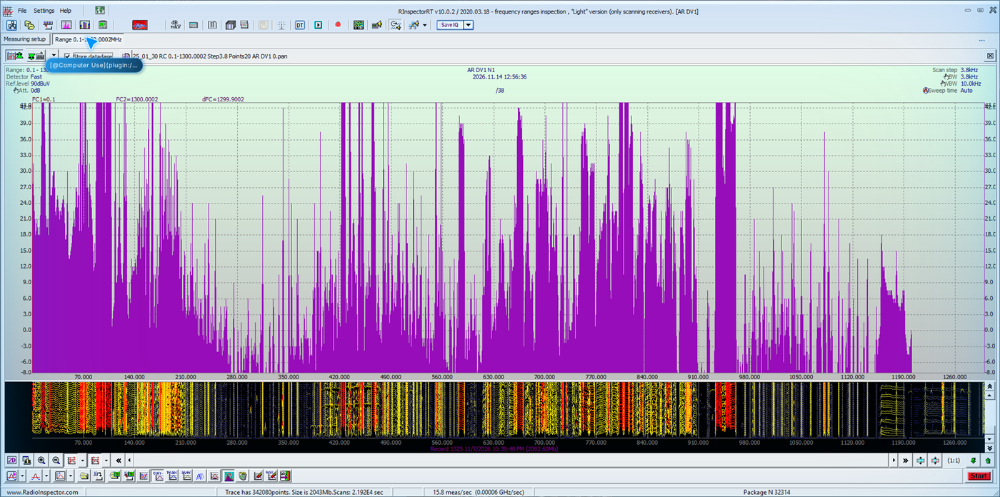

*Спектрограмма с границами диапазона (`FC1`, `FC2`, `dFC`), параметрами
детектора (`Fast`, `SDoBu`, `fAtt`), шагом сканирования и водопадной
панорамой; справа — параметры свипа и подпись записи `AR DV1 N1`.*

### 9.2. Настройка измерительного тракта

*Группа «Measuring instrument» (Instrument 1: COM3 / 115200, модель AR DV1,
состояние приёмника) и группа «Audio source» (Model = Unused); внизу —
вкладки Navigation receiver, External antenna switcher, ECM (jamming),
Antenna compass; в области настройки — сообщение о неустановленной опции
RC-GEO.*

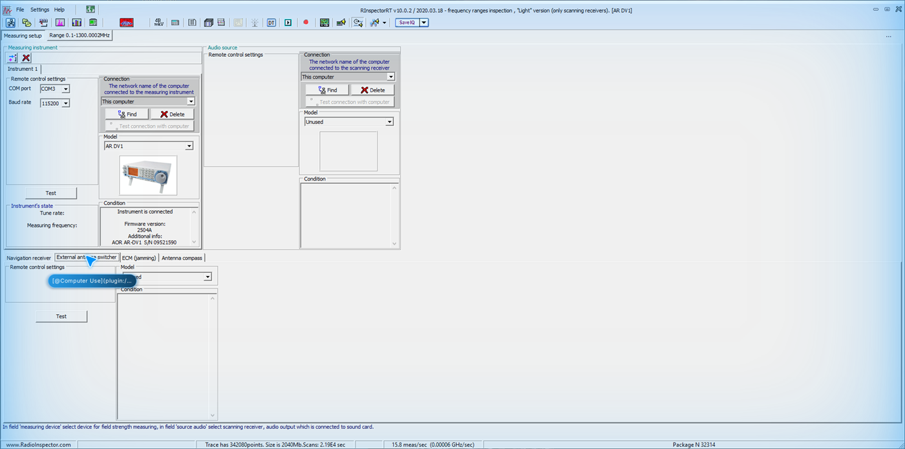

### 9.3. Меню

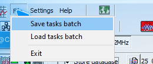

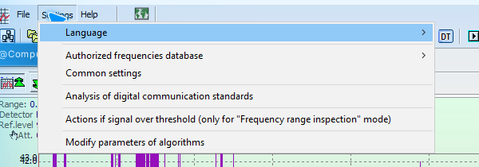

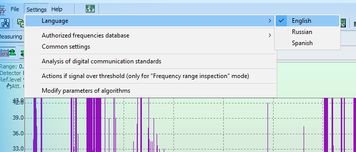

### 9.4. Настройки (Common settings)

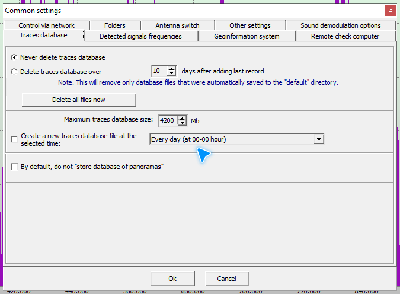

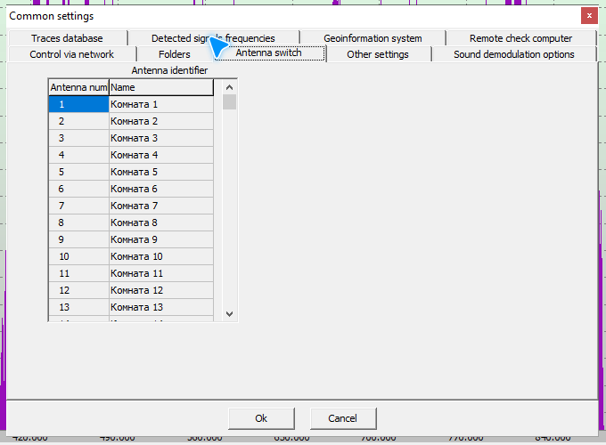

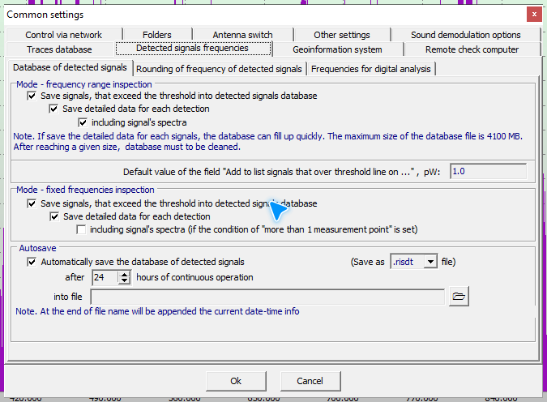

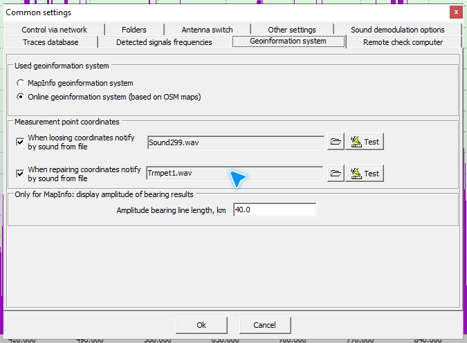

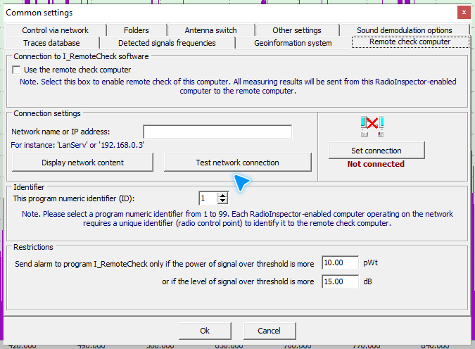

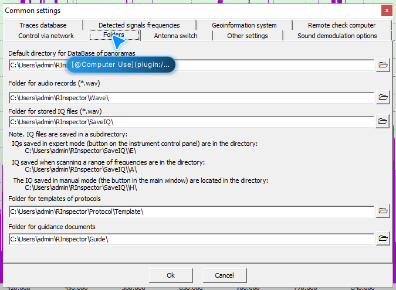

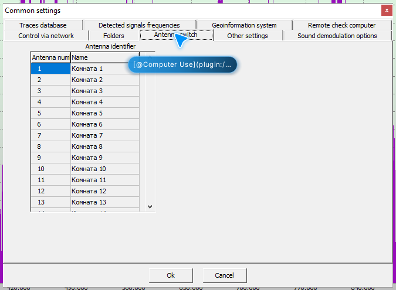

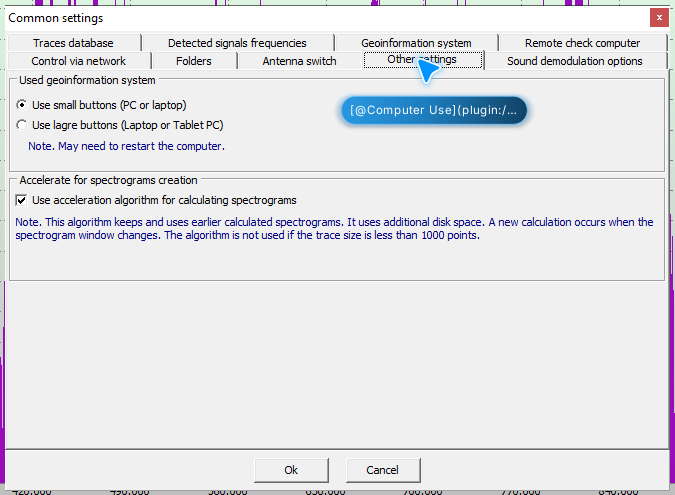

### 9.5. Реакция на превышение порога и отсутствующие опции

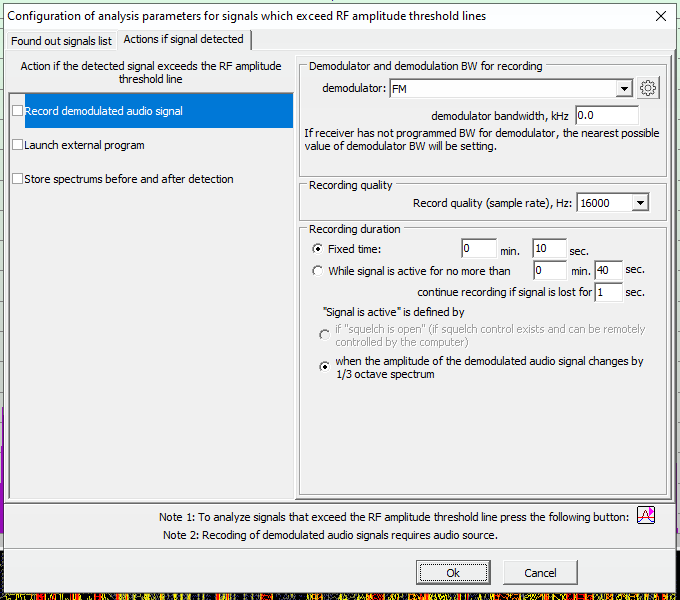

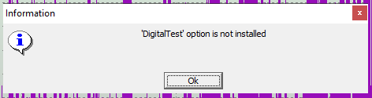
