# RInspectorRT (RadioInspector Light): инвентарь возможностей по работающей программе

Документ фиксирует возможности **RInspectorRT** (программа `RInspectorRT` из
пакета **RadioInspector Light**, номер пакета 32314) по результатам
**непосредственного наблюдения работающей программы** на компьютере
разработчика: интерфейс открыт, подключён измерительный приёмник AOR AR-DV1,
показана панорама диапазона и включён параметр сохранения в базу.
Создание и прирост файла отдельной проверкой не подтверждены.

Это дополнение к статическому инвентарю дистрибутива
[capabilities-light-32314.md](capabilities-light-32314.md) и к сравнительному
отчёту [radioinspectorrt-comparison-report.md](radioinspectorrt-comparison-report.md):
документы описывают состав дистрибутива и публичные сведения, этот — поведение
программы, наблюдаемое в работающем состоянии.

> **Метод наблюдения.** Изучение выполнено средствами автоматизации рабочего
> стола (Computer Use): снимки экрана, дерево элементов интерфейса и
> фактические состояния элементов управления. Все утверждения ниже относятся к
> наблюдаемому состоянию; нефункциональные и недоступные пункты помечены
> явно. Снимки экрана приведены в каталоге
> `docs/images/rinspectorrt-light/`.

> **Корректировка версии.** Первичная правка этого документа ошибочно
> указывала версию как `v1.0.2`. Диалог `Help ▸ About` наблюдаемой
> программы сообщает **Version 10.0.2 / 2020.03.18**, и заголовок окна при
> увеличении читается как `RInspectorRT v10.0.2 / 2020.03.18`. Версия в
> документе исправлена на `v10.0.2`. Раздел 10 описывает второй сеанс
> наблюдения, дополняющий первые девять разделов; раздел 11 — третий сеанс с
> подключённым приёмником AOR AR-DV1; раздел 12 — каталог всех окон и
> диалогов программы со снимками и комментариями.

---

## 1. Идентификация наблюдаемой программы

| Характеристика | Наблюдаемое значение | Источник |
|---|---|---|
| Исполняемый файл | `C:\Program Files (x86)\RadioSoft\RadioInspector Light\InspectorRT.exe` | файловая система |
| Размер исполняемого файла | 13 398 528 байт (13,4 МБ) | файловая система |
| Заголовок главного окна | `RInspectorRT v10.0.2 / 2020.03.18 - frequency ranges inspection, "Light" version (only scanning receivers). [AR DV1]` | снимок экрана |
| Номер пакета в строке состояния | `Package N 32314` | снимок экрана |
| Ресурсы рядом с программой | `LangRC.sib`, `GrdVkc32.dll`, `Idevim.dll`, `libfftw3f-3.dll`, `FreeImage.dll`, `rsib32.dll`, `MagneticVariation.dat`, `DefFoldersPath.txt` | файловая система |
| Ресурс версии в PE-ресурсах | отсутствует (сборка Delphi/VCL, версию сообщает только заголовок окна) | `Get-Item ... | VersionInfo` |
| Файл `DefFoldersPath.txt` | путь к рабочему каталогу закомментирован (`rem c:\RadioInspectorData`) | файловая система |
| Рабочие папки, показанные программой | `C:\Users\admin\RInspector` (`SaveIQ`, `Protocol\Template`, `Wave`, `DataBase`, `Guide`) | вкладка «Folders» |
| Измерительный приёмник | AOR AR-DV1, S/N 09521590, прошивка 2504A | вкладка «Measuring setup» |
| Интерфейс приёмника | COM3, 115200 бод, подключение «This computer» | вкладка «Measuring setup» |

**Расхождение с документацией репозитория.** В
[capabilities-light-32314.md](capabilities-light-32314.md) для пакета 32314
указана сборка `7.6.0.1` (по ресурсам `InspectorRT.exe` дистрибутива) и
рабочие папки `c:\RadioInspectorData`. Наблюдаемая установка сообщает о
версии интерфейса **v10.0.2 / 2020.03.18** и использует каталог
`C:\Users\admin\RInspector`. Номер пакета совпадает (32314), но PE-версия
дистрибутива и версия интерфейса не устанавливают хронологию сборок.
Рабочие пути приведены для наблюдаемой установки, не для всех установок пакета.

---

## 2. Структура интерфейса

Главное окно — одна панель с двумя вкладками верхнего уровня и двумя
панелями инструментов (верхняя и нижняя), строкой состояния и подсказкой
ввода.

| Элемент | Наблюдение |
|---|---|
| Вкладки верхнего уровня | `Measuring setup `, `Range 0.1-1300.0002MHz` |
| Верхняя панель инструментов | 21 кнопка без подписей (доступны по пиктограммам), индикатор режима `dB/mkV`, кнопка `DT`, переключатель запуска записи, кнопка `Save IQ` с выпадающим списком |
| Нижняя панель инструментов | кнопки панорамирования и масштабирования, выбор `PAN`/`DBM`, маркеры, кнопки `OPRR`, `RSI`, `ISVI`, переключатель `Start` |
| Строка состояния | `www.RadioInspector.com`; `Trace has 342080 points. Size is 2040Mb. Scans: 2.19E4 sec`; `15.8 meas/sec (0.00006 GHz/sec)`; `Package N 32314` |
| Подсказка ввода | «In field 'measuring device' select device for field strength measuring, in field 'source audio' select scanning receiver, audio output which is connected to sound card.» |

### 2.1. Меню

| Меню | Пункты |
|---|---|
| `File` | Save tasks batch; Load tasks batch; Exit |
| `Settings` | Language ▸ (English / Russian / Spanish); Authorized frequencies database ▸ (Display; Find); Common settings; Analysis of digital communication standards; Actions if signal over threshold (only for "Frequency range inspection" mode); Modify parameters of algorithms |
| `Help` | About |

Меню предлагает `Save tasks batch` / `Load tasks batch`. Перенос файла между
рабочими местами и обратная загрузка в этом наблюдении не проверялись;
наличие этих пунктов не устанавливает отсутствие сетевого транспорта.

### 2.2. Пункт «Analysis of digital communication standards»

При активации программа выдаёт модальное окно `Information` с сообщением
**«DigitalTest option is not installed»**. Соответствующая опция в
наблюдаемой сборке отсутствует: анализ цифровых стандартов и
классификация сигналов в Light 32314 недоступны.

### 2.3. Пункт «Actions if signal over threshold …»

Открывает окно **«Configuration of analysis parameters for signals which exceed
RF amplitude threshold lines»** — конфигурацию реакции на превышение
пороговых линий. Окно содержит две вкладки:

* `Found out signals list` — список найденных сигналов;
* `Actions if signal detected` (активна) — параметры реагирования.

Наблюдаемые элементы вкладки «Actions if signal detected»:

| Элемент | Значение / состояние |
|---|---|
| Radio «when the amplitude of the demodulated audio signal changes by 1/3 octave spectrum» | выбрано |
| Radio «While signal is active for no more than» | не выбрано |
| Radio «Fixed time:» | выбрано |
| Поля времени/длительности | `0.0`, `0`, `10`, `0`, `1`, `40` |
| Частота дискретизации записи, Гц | `16000` |
| Выбор вида модуляции | `FM` |

Диалог разделяет превышение RF-порога, выбираемое действие и длительность
аудиозаписи. `Fixed time` задаёт длительность (10 секунд), а альтернативный
режим ограничивает запись временем активности сигнала. Анализ третьоктавного
спектра относится к определению активности аудио, не к изменению уровня
«на треть октавы». На снимке флажок `Record demodulated audio signal` снят;
срабатывание записи и её результат не проверялись. См. также снимок 55.

---

## 3. Режим контроля диапазона (вкладка «Range 0.1-1300.0002MHz»)

### 3.1. Спектрограмма

Основное рабочее поле — спектрограмма (спектр по горизонтали, уровень по
вертикали) с наложенными границами диапазона и пороговыми линиями.

| Параметр | Наблюдаемое значение |
|---|---|
| Диапазон `Range` | 0,1 – 1300,0002 МГц |
| `FC1` / `FC2` | 0,1 / 1300,0002 МГц |
| `dFC` | 1299,9002 МГц |
| Детектор | `Fast` |
| `ReLevel` | `SDoBu` (обозначение интерфейса; трактовка единицы не проверялась) |
| `fAtt` | 0 дБ (отображаемое значение ослабления) |
| Шаг сканирования | 3,8 кГц |
| `ψBW` | 3,8 кГц / 10,0 кГц |
| `Sweep time` | `Auto` |
| Точек в трассе | 342 080 (≈ 2040 МБ на файл) |
| Темп измерений | 15,8 изм/с (0,00006 ГГц/с) |
| Подпись записи | `AR DV1 N1`, отметка времени `2026.11.14 12:56:36`, прогресс `/38` |

Верхняя панель содержит кнопку `dB/mkV`; в настройках отображается `SDoBu`.
Соответствие показаний физической величине и калибровочный профиль не
исследовались. `fAtt = 0 дБ` не доказывает отсутствие калибровки. Для
сопоставления с OpenRadioInspector нужны исходные единицы и документированный
способ их получения; преобразование показаний AR-DV1 в дБм здесь не подтверждено.

### 3.2. Водопадная диаграмма (панорама)

Под спектрограммой — панорама (waterfall) с цветовой развёрткой во времени:
отдельные записи видны красными и жёлтыми полосами на чёрном фоне, шкала
времени `Record 1325 11/7/2026 10:39:40 PM (2002.60kb)`. Поддерживаются
маркеры на панораме (кнопки нижней панели) и переключатель `PAN`/`DBM`.

### 3.3. Файлы и база данных

| Элемент | Наблюдение |
|---|---|
| Поле файла панорамы | `25_01_30 RC 0.1-1300.0002 Step3.8 Points20 AR DV1 0.pan` |
| Флажок `Store datadase` | включён (в интерфейсе — опечатка оригинала) |
| Кнопка `Открыть` рядом с полем | открытие файла панорамы |
| Кнопка `Save IQ` | видимая кнопка с выпадающим списком; запись, формат и источник IQ не проверены |
| Список источников | `1: AR DV1` (выпадающий список приёмников) |

---

## 4. Панель измерений (вкладка «Measuring setup»)

### 4.1. Измерительный приёмник («Instrument 1»)

Группа **Remote control settings**: COM-порт (`COM3`), скорость (`115200`),
кнопка `Find` (поиск прибора), `Delete` (удаление записи о приборе),
`Test connection with computer` (проверка связи), поле выбора подключения
(`This computer` — локально или удалённо по сети).

Группа **Model**: выбран приёмник `AR DV1` (изображение прибора).

Группа **Instrument's state**: `Tune rate`, `Measuring frequency` — значения
в наблюдении не заполнены (заполняются в ходе работы).

Группа **Condition**: «Instrument is connected», `Firmware version: 2504A`,
`Additional info: AOR AR-DV1 S/N 09521590`.

### 4.2. Источник звука (аудиоконтроль)

Вторая группа — **Audio source / Remote control settings**: тот же набор
параметров удалённого управления (подключение `This computer`, кнопки
`Find` / `Delete` / `Test connection with computer`), поле **Model** со
значением `Unused` и пустая группа **Condition**. То есть в наблюдаемой
конфигурации источник звука не выбран. Это не устанавливает состав лицензии:
About отдельно сообщает `RC-Sound = yes`, `RC-SoundScanner = no` (раздел 10.1).
Захват и воспроизведение звука в сеансе не проверялись.

### 4.3. Дополнительные вкладки настройки

| Вкладка | Наблюдение |
|---|---|
| `Navigation receiver` | панель подключения навигационного приёмника (COM3 / 115200, `This computer`, модель не выбрана) |
| `External antenna switcher` | панель подключения внешнего антенного коммутатора; модель не выбрана |
| `ECM (jamming)` | панель управления передатчиком радиоэлектронного подавления; в наблюдении заполнена только базовая часть |
| `Antenna compass` | панель антенного компаса; в наблюдаемой Light-сборке дополнительных элементов не раскрывает |

### 4.4. Неустановленные опции

В области настройки программа выводит сообщение **«'RC-GEO' option is not
installed»** — геоинформационная система (опция RT-Geo) в Light-сборке
отсутствует. Это подтверждает зафиксированное в
[capabilities-light-32314.md](capabilities-light-32314.md) ограничение:
в Light не поддерживается геоинформационная система.

---

## 5. Настройки (Settings ▸ Common settings)

Диалог имеет девять вкладок: `Control via network`, `Traces database`,
`Folders`, `Detected signals frequencies`, `Antenna switch`,
`Geoinformation system`, `Other settings`, `Sound demodulation options`,
`Remote check computer`.

### 5.1. Traces database (база записей панорам)

| Элемент | Значение / состояние |
|---|---|
| «Never delete traces database» | выбрано |
| «Delete traces database over [10] days after adding last record» | не выбрано; пояснение: удаляются только файлы, автоматически сохранённые в каталог «default» |
| «Delete all files now» | кнопка немедленного удаления файлов базы |
| «Maximum traces database size: [4200] Mb» | предел размера базы |
| «Create a new traces database file at the selected time:» | не выбрано; значение — «Every day (at 00-00 hour)» |
| «By default, do not "store database of panoramas"» | не выбрано |

Механика суточной ротации файлов базы и лимита размера — готовый образец
политики хранения архива измерений; в OpenRadioInspector аналог — разбор
по `docs/archive-capacity.md` и `docs/archive-snapshot.md`.

### 5.2. Detected signals frequencies (база обнаруженных сигналов)

| Элемент | Значение / состояние |
|---|---|
| Файл базы | `.risdt` (поле + кнопка «Открыть») |
| Автосохранение базы обнаруженных сигналов | включено, через 24 часа непрерывной работы |
| Сохранение спектров при контроле диапазона | флажок включён |
| Сохранение спектров на фиксированных частотах при условии «more than 1 measurement point» | флажок выключен |
| «Save detailed data for each detection» | включено |
| «Save signals, that exceed the threshold into detected signals database» | включено |

### 5.3. Folders (рабочие папки)

| Назначение | Путь |
|---|---|
| IQ-записи | `C:\Users\admin\RInspector\SaveIQ` |
| Шаблоны протоколов | `C:\Users\admin\RInspector\Protocol\Template` |
| Фонограммы | `C:\Users\admin\RInspector\Wave` |
| База данных | `C:\Users\admin\RInspector\DataBase` |
| Справочные материалы | `C:\Users\admin\RInspector\Guide` |

### 5.4. Прочие вкладки

| Вкладка | Наблюдение |
|---|---|
| `Other settings` | «Use acceleration algorithm for calculating spectrograms» — включено; «Use large buttons (Laptop or Tablet PC)» / «Use small buttons (PC or laptop)» — выбран вариант для ПК |
| `Sound demodulation options` | «All communication sessions is recorded in separate file» — выбрано; «Each channel is recorded in separate file» — присутствует как альтернатива |
| `Antenna switch` | список позиций антенного коммутатора с прокруткой |
| `Control via network` | числовое поле (значение `3`) — параметр сетевого управления |
| `Geoinformation system` | элементы недоступны: опция RC-GEO не установлена |
| `Remote check computer` | элементы недоступны в Light-сборке (нет программы I_RemoteCheck) |

### 5.5. Authorized frequencies database (база разрешённых частот)

Подменю **Settings ▸ Authorized frequencies database** содержит два пункта:
**Display** (просмотр базы частотных присвоений) и **Find** (поиск по базе).
Само меню не доказывает доступность базы. Наличие опции `SLIST = yes`
подтверждено в About; Display и Find в наблюдаемой установке сообщают
об отсутствии Firebird (разделы 10.1–10.2).

### 5.6. Язык интерфейса

**Settings ▸ Language**: English (активен в наблюдении), Russian, Spanish.

---

## 6. Сопоставление с документацией репозитория

| Утверждение документации репозитория | Наблюдение в работающей программе | Итог |
|---|---|---|
| Light управляет только сканирующими приёмниками | в заголовке окна — «"Light" version (only scanning receivers)»; приёмник AR-DV1 | подтверждено |
| Геоинформационная система в Light не поддерживается | «'RC-GEO' option is not installed» | подтверждено |
| Опция DigitalTest отсутствует | «DigitalTest option is not installed» | подтверждено |
| Опция SoundScaner отсутствует | About: `RC-SoundScanner = no`, при этом `RC-Sound = yes` | подтверждено для наблюдаемой установки |
| Опция SList включена | About: `SLIST = yes` | подтверждено; работа базы заблокирована отсутствием Firebird |
| Рабочие папки — `c:\RadioInspectorData` | наблюдается `C:\Users\admin\RInspector` | различие путей установок |
| PE-версия 7.6.0.1 | интерфейс: `v10.0.2 / 2020.03.18` | разные источники версии; хронология не установлена |
| Запись и анализ демодулированного аудиосигнала встроены | доступны параметры записи; флажок записи снят | интерфейс наблюдался, работа записи/анализа не проверена |
| Программа пишет файлы панорам | файл `…0.pan` в поле выбора, флажок «Store datadase», папка `DataBase` | наблюдалась настройка сохранения; создание и прирост файла не проверены |

---

## 7. Что стоит перенести в OpenRadioInspector

Наблюдения дают следующие ориентиры для открытой реализации (решения
принимаются в коде; доступность элементов интерфейса не заменяет проверку
операций на конкретном оборудовании):

1. **Раздельное хранение панорам и сигналов.** База панорам (`.pan`) и база
   обнаруженных сигналов (`.risdt`) — разные сущности с разными политиками
   хранения; в OpenRadioInspector это разные таблицы/файлы архива.
2. **Политика хранения базы панорам.** Не удалять / удалять старше N дней /
   лимит размера / суточная ротация файла — готовый набор параметров,
   сопоставимый с `docs/archive-capacity.md`.
3. **Порог и линия порога как явный объект.** Порог задаётся линией
   (частота → уровень), а превышение порога порождает событие с
   настраиваемым действием. Настройки действия, длительности записи и критерия
   активности следует разделять. Это ближе к `docs/adaptive-sweep-threshold.md`,
   чем к бинарному порогу.
4. **Пакетный обмен заданиями файлами.** «Save tasks batch» / «Load tasks
   batch» — минимальный транспорт между рабочими местами; сопоставимо с
   форматом заданий в `docs/measurement-results.md`.
5. **Состояние калибровки должно быть явным.** В этом наблюдении оно неизвестно.
   Сохранять исходные измерения и единицы; физические преобразования требуют
   документированного применимого профиля, а не вывода из положения аттенюатора.
6. **Опции должны быть явными.** Часть возможностей Light (DigitalTest,
   RC-GEO, RC-SoundScanner) отмечена как неустановленная в About; для
   DigitalTest и RC-GEO также наблюдались сообщения об отсутствии опции. Для открытой реализации это аргумент за явные
   профили устройств и опций вместо скрытых деградаций.

---

## 8. Границы наблюдения

* Наблюдение охватывает интерфейс и состояние элементов управления при
  подключённом AR-DV1; сетевые сценарии, реальные измерения параметров
  сигнала, работа опции DigitalTest и модулей, отсутствующих в сборке,
  не проверялись.
* В третьем сеансе наблюдались состояние подключения AR-DV1, отображение
  диапазона, перенос курсора и пункты экспорта. Файл результата экспорта и
  последовательный журнал поступления новых измерений не представлены.
  Происхождение разнородных временных меток не установлено.
* Абсолютная метрологическая пригодность не оценивалась: калибровка тракта
  и антенны вне зоны наблюдения.
* Версия интерфейса v10.0.2 / 2020.03.18 отличается от PE-версии в статическом
  инвентаре. Хронология сборок не установлена; состав опций относится к этой копии.
* Оформление и надписи воспроизведены как в оригинале, включая опечатки
  оригинального интерфейса (`Store datadase`).

---

## 9. Снимки экрана

Все снимки сделаны с работающей программы 14 ноября 2026 года и лежат в
каталоге `docs/images/rinspectorrt-light/`.

### 9.1. Контроль диапазона


*Спектрограмма с границами диапазона (`FC1`, `FC2`, `dFC`), параметрами
детектора (`Fast`, `SDoBu`, `fAtt`), шагом сканирования и водопадной
панорамой; справа — параметры свипа и подпись записи `AR DV1 N1`.*

### 9.2. Настройка измерительного тракта

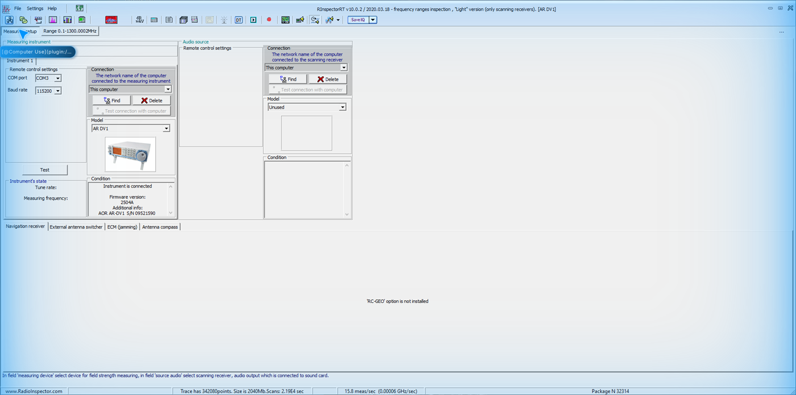

*Группа «Measuring instrument» (Instrument 1: COM3 / 115200, модель AR DV1,
состояние приёмника) и группа «Audio source» (Model = Unused); внизу —
вкладки Navigation receiver, External antenna switcher, ECM (jamming),
Antenna compass; в области настройки — сообщение о неустановленной опции
RC-GEO.*

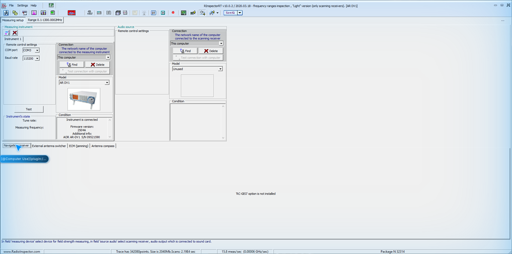


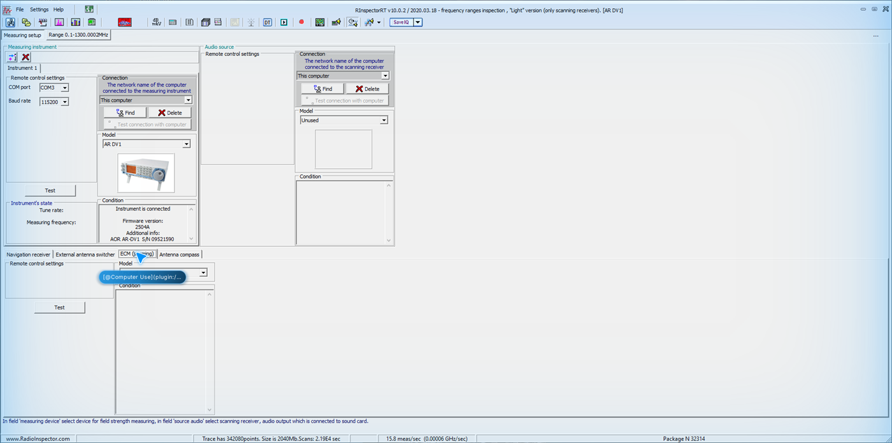

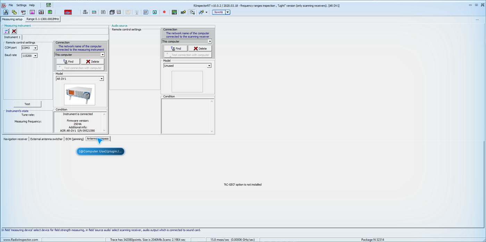

### 9.3. Меню


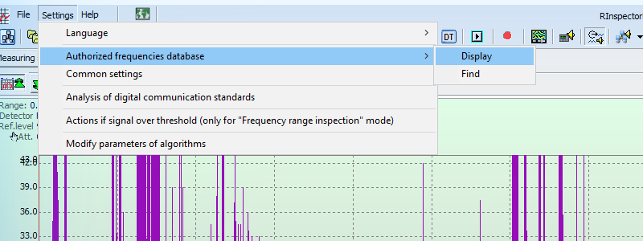

### 9.4. Настройки (Common settings)


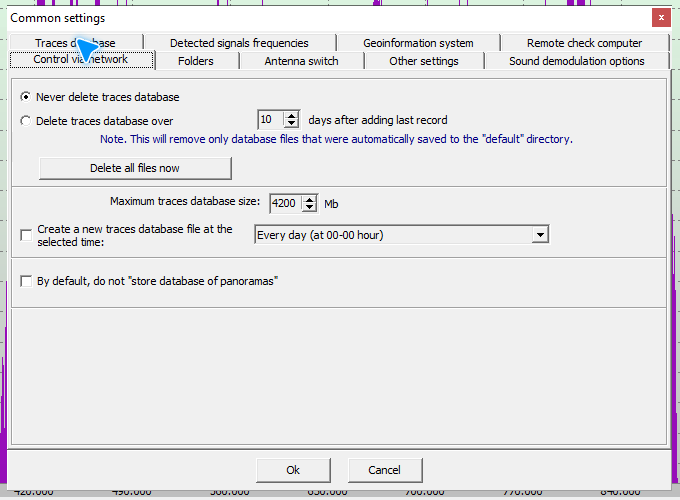

Имена файлов 08 и 12 сохранены для связи с первым сеансом. Вкладки
Detected signals frequencies и Control via network показаны на снимках 09 и 46.


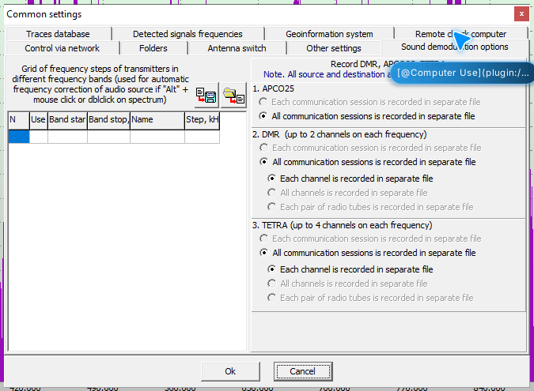

### 9.5. Реакция на превышение порога и отсутствующие опции


---


### 9.6. Живой сеанс с приёмником AOR AR-DV1

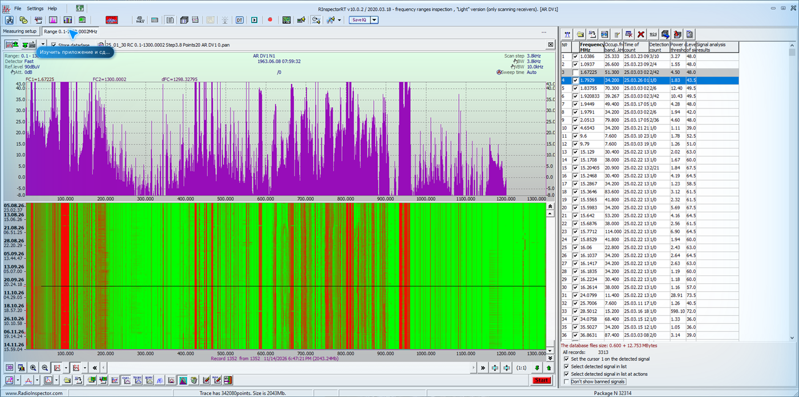

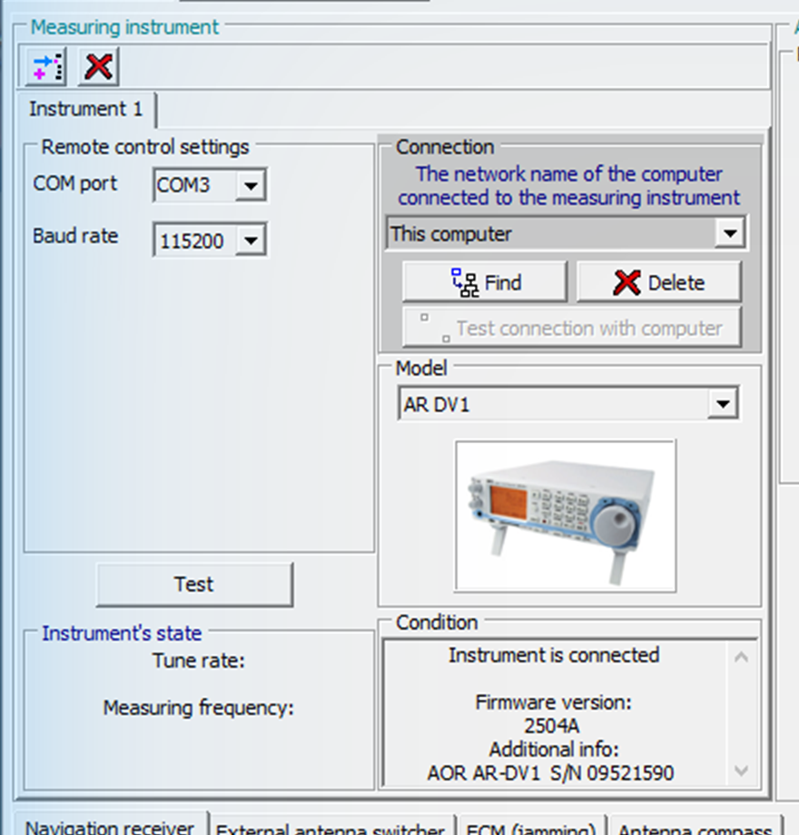

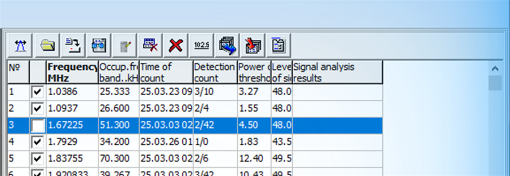

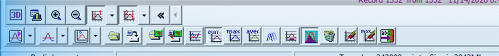

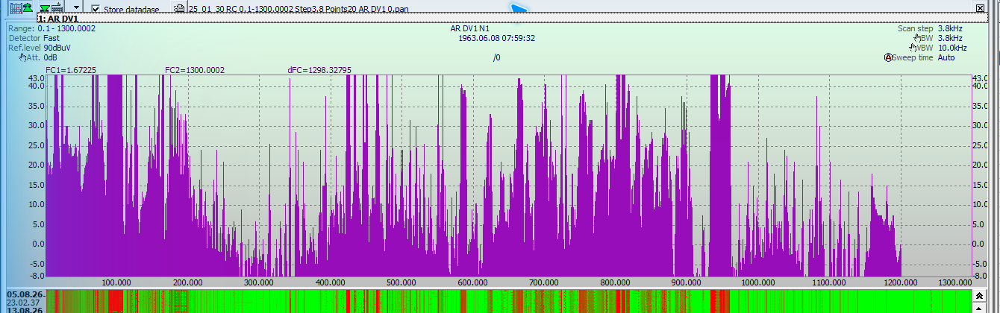

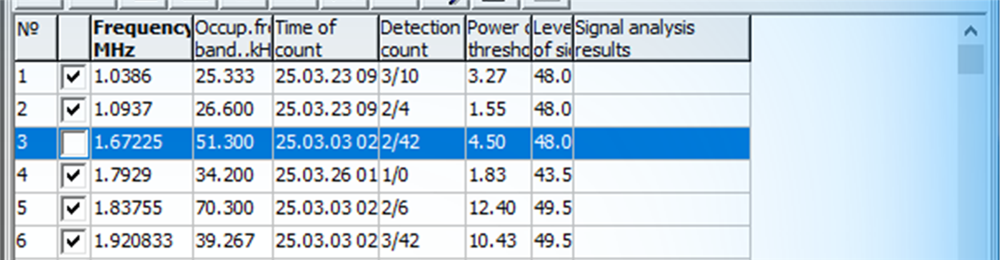

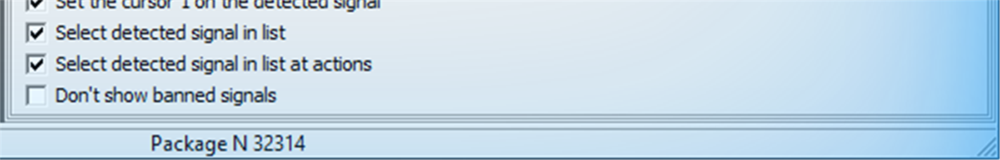

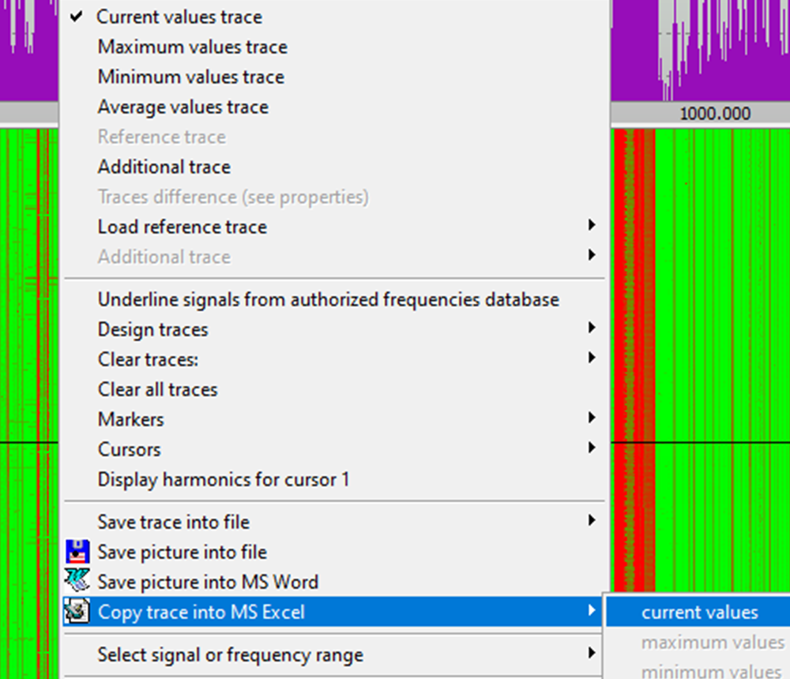

## 10. Второй сеанс наблюдения: About, состав опций и зависимость от Firebird

Программа была перезапущена и изучена повторно: сняты снимки всех вкладок,
разобраны безымянные кнопки панелей инструментов, открыты ранее не показанные
диалоги. Ниже — новые наблюдения, дополняющие разделы 1–9.

### 10.1. Диалог About: назначение программы и установленные опции

`Help ▸ About` открывает окно **«About»**, где программа описывает себя как
«A comprehensive program for frequency range (F1→F2) and fixed frequency
(F1, F2, F3…Fn) scanning, analysis, storing and post processing» и
перечисляет заявленные возможности:

* экспертный анализ спектральных и амплитудно-частотно-временных
  характеристик принятых сигналов;
* удалённое управление по TCP/IP, включая передачу демодулированного
  аудиосигнала в реальном времени;
* сохранение всех результатов измерений для последующего анализа;
* анализ IQ-данных для DECT, Bluetooth, GSM, Tetra, аналогового ТВ, APCO25,
  DRM и trunking-систем, с автоматическим распознаванием сигналов при
  сканировании.

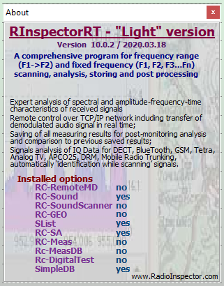

Таблица **Installed options** в этом окне даёт фактический состав опций
наблюдаемой сборки:

| Опция | Состояние |
|---|---|
| RC-RemoteMD | no |
| RC-Sound | yes |
| RC-SoundScanner | no |
| RC-GEO | no |
| SLIST | yes |
| RC-SA | yes |
| RC-Meas | no |
| RC-MeasDB | no |
| RC-DigitalTest | no |
| SimpleDB | yes |

Это **снимает неоднозначность** статического инвентаря: в
[capabilities-light-32314.md](capabilities-light-32314.md) состояние опции SA
отмечено как «спорно» — строка `ReadMe.txt` содержит «RC-SA — есть» и
«RC-SA — нет» одновременно. Работающая программа сообщает **RC-SA = yes**,
а RC-Meas, RC-MeasDB, RC-RemoteMD, RC-SoundScanner, RC-GEO и RC-DigitalTest —
**нет**. Это согласуется с наблюдением: измерительные параметры сигналов
(RC-Meas) и база результатов измерений (RC-MeasDB) в Light отсутствуют.

### 10.2. Зависимость от Firebird

При запуске программа выдаёт сообщение:

> Firebird database software is not installed on your computer. Use of
> authorised frequencies and measuring results databases is not possible. In
> order to use these databases, please install Firebird database software.

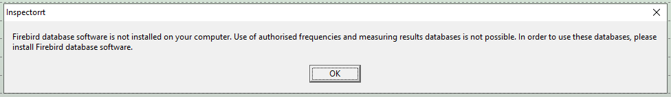

То же сообщение появляется при обращении к **Settings ▸ Authorized
frequencies database ▸ Display**. Практический вывод: база разрешённых
частот (опция SLIST) и база результатов измерений реализованы поверх СУБД
Firebird и без установленного сервера Firebird неработоспособны: пункты
меню присутствуют, но нефункциональны. В пакете 32314 FireBird 2.5 входит в
состав дистрибутива, на рабочей станции без него эти функции недоступны.

### 10.3. База записей панорам и продолжение сеанса

При переключении на вкладку диапазона программа предлагает продолжить запись
в файл базы записей предыдущего сеанса:

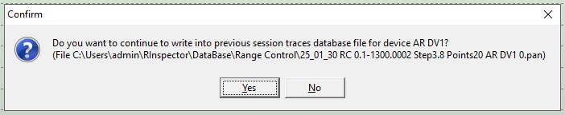

> Do you want to continue to write into previous session traces database file
> for device AR DV1?
> (File C:\Users\admin\RInspector\DataBase\Range Control\25_01_30 RC 0.1-1300.0002 Step3.8 Points20 AR DV1 0.pan)

| Элемент | Значение |
|---|---|
| Каталог базы записей | `…\RInspector\DataBase\Range Control\` |
| Шаблон имени файла | `<дата> RC <F1>-<F2> Step<шаг> Points<число точек> <приёмник> <индекс>.pan` |
| Пример | `25_01_30 RC 0.1-1300.0002 Step3.8 Points20 AR DV1 0.pan` |
| Привязка | файл привязан к конкретному приёмнику (device AR DV1) |

### 10.4. «Modify parameters of algorithms» → Signal's digital processing

Пункт меню **Settings ▸ Modify parameters of algorithms** открывает окно
**«Signal's digital processing»**:

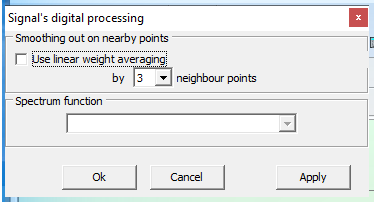

| Элемент | Значение / состояние |
|---|---|
| «Smoothing out on nearby points» | группа параметров сглаживания |
| «Use linear weight averaging» | не выбрано |
| «by [3] neighbour points» | число соседних точек, участвующих в усреднении |
| «Spectrum function» | выпадающий список функций обработки (значение не выбрано) |
| Кнопки | Ok / Cancel / Apply |

Обработка отсчётов идёт по соседним точкам с возможностью линейного
взвешивания. Для OpenRadioInspector это аргумент описать сглаживание как
отдельный шаг конвейера обработки с явными параметрами окна и весов.

### 10.5. Порог: вкладка «Found out signals list»

В диалоге «Configuration of analysis parameters for signals which exceed RF
amplitude threshold lines» вкладка **«Found out signals list»** задаёт порядок
и фильтрацию списка найденных сигналов:

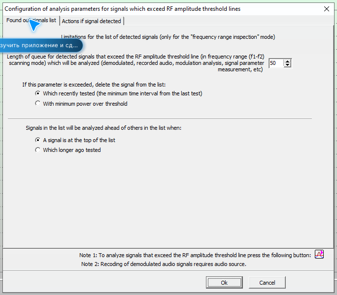

| Элемент | Состояние |
|---|---|
| «Which longer ago tested» | не выбрано |
| «A signal is at the top of the list» | выбрано |
| «Which recently tested (the minimum time interval from the last test)» | выбрано |
| «With minimum power over threshold» | не выбрано |
| Числовое поле | 50 |

Найденные сигналы упорядочиваются по времени последней проверки либо по
времени, прошедшему с последней проверки; отбор — по мощности над порогом.
Это конкретный образец политики «показывать недавно обнаруженное», а не
только накопительный список.

### 10.6. Панели инструментов

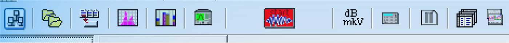


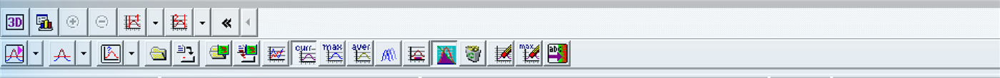

Верхняя панель (21 безымянная кнопка плюс подписи): дерево подключённых
приборов, открытие и правка задания, импорт задания, просмотр панорамы,
просмотр результатов, панель управления измерением, запуск сканирования,
переключатель единиц `dB`/`мкV`, мини-индикатор уровня, пауза, список
заданий и отчётов, кнопка `DT` (DigitalTest), воспроизведение, запись,
растровый режим, источник звука, пара курсоров, вывод звука с регулятором и
кнопка `Save IQ` с выпадающим списком.

Нижняя панель — две строки:

* верхняя: режим `3D`, монитор со спектром, масштаб `+`/`−`, два
  выпадающих списка маркеров и линий, прокрутка `«`/`◄`;
* нижняя: выпадающий список режима отображения (спектр/панорама), выпадающий
  список детектора, выпадающий список уровня и порога, открыть панораму,
  импорт задания, результаты измерений, база панорам, протокол и отчёт,
  отметки `cur:`, `max:`, `aver`, IF и водопад, панорама, `3D`-панорама,
  экспорт, редактор максимумов, редактор линии порога, сравнение `ab`;
* справа: пошаговая и ускоренная прокрутка, масштаб по вертикали, масштаб
  `1:1`, сброс и красная кнопка `Start`.

Кнопка `Start` открывает диалог конфигурации параметров анализа для
сигналов, превышающих порог: запуск измерения сопровождается настройкой
реакции на превышение порога.

### 10.7. Поведение без подключённого приёмника

После перезапуска, когда COM3 не был занят другим экземпляром, панель
состояния приёмника показывает **«Error! Verify COM port (COM3)»**; в
спектре отображается шумовая полка с относительным уровнем около 62–81 дБ,
строка состояния — «Trace has 20points.», панорама пуста. При этом интерфейс
полностью работоспособен: доступны все меню, настройки и разбор файлов.
Программа не является «приборной приставкой»: оболочка и обработка файлов
работают без оборудования.

### 10.8. Несколько заданий диапазона

После перезапуска программа восстановила задание предыдущего сеанса:
вкладка **«Range 85.0-110.0MHz»** (85–110 МГц, 20 точек трассы) — задания
диапазонов хранятся вместе с сеансом и открываются как отдельные вкладки.

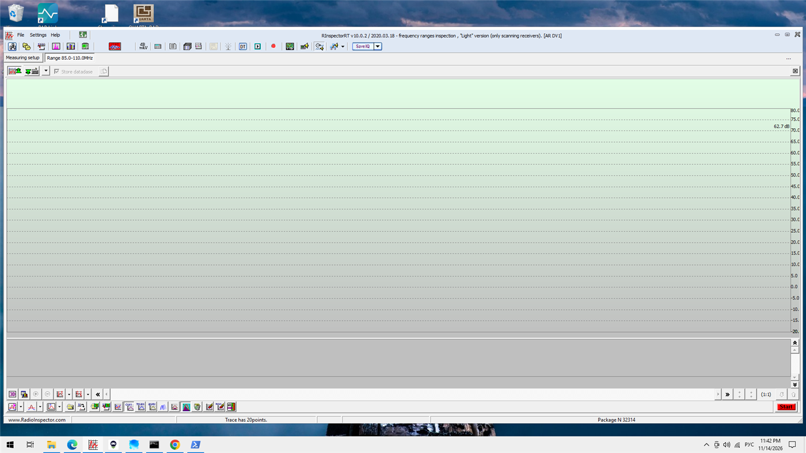

*Вкладка «Range 85.0-110.0MHz» с восстановленным заданием: диапазон, число
точек трассы и параметры сканирования сохраняются вместе с сеансом.*
Панель над спектрограммой содержит список источников (приёмников), флажок
`Store datadase`, кнопку добавления или удаления источника и кнопку
закрытия вкладки.

## 11. Третий сеанс: работа с подключённым приёмником AOR AR-DV1

### 11.1. Подключение и состояние приёмника

К COM3 подключён приёмник AOR AR-DV1 (USB-UART мост Silicon Labs CP210x,
115200 бод, S/N 09521590, firmware 2504A). Программа опознаёт прибор сама:
во вкладке Measuring setup группа «Measuring instrument» показывает
Model = `AR DV1` с фотографией аппарата, а поле «Instrument's state»
содержит:

```
Instrument is connected
Firmware version: 2504A
Additional info: AOR AR-DV1  S/N 09521590
```

В заголовке главного окна появилась метка прибора: «RInspectorRT v10.0.2 /
2020.03.18 — frequency ranges inspection … [AR DV1]».

Поля «Instrument 1» заполнены значениями COM3 и 115200. Кнопка `Test`
доступна, а флажок «Test connection with computer» неактивен, пока не выбран
удалённый компьютер (в группе Connection стоит `This computer`). Группа
«Audio source» остаётся `Unused`: источник звука не выбран. About показывает
`RC-Sound = yes`; фактический аудиозахват не проверялся. Поля «Tune rate» и
«Measuring frequency» пусты; условия их заполнения не исследовались.

### 11.2. Живое измерение диапазона

На вкладке «Range 0.1-1300.0002MHz» видны следующие значения:

* шаг сетки 3.8 кГц, ширина канала ψBW 3.8/10.0 кГц, Sweep time = Auto;
* Detector: Fast, fAtt: 0 dB, Ref.level: 90 dBµV;
* «Trace has 342080points. Size is 2043Mb.»;
* «Record 1352 from 1352», дата `11/14/2026 6:47:21 PM`;
* отображены спектрограмма и водопад, шкала частот доходит до 1200+ МГц.

**Происхождение временных меток не установлено.** На снимке 32 одновременно
видны `1963.06.08 07:59:32`, `11/14/2026 6:47:21 PM` и записи списка с другими
датами. Не проверено, относятся ли они к архиву, компьютеру или прибору.
Оснований приписывать расхождение часам AR-DV1 нет. Одиночный снимок также
не доказывает непрерывное поступление свежих измерений: для этого нужен
журнал или последовательность кадров с новыми записями и установленным UTC.

### 11.3. Список найденных сигналов и курсор в спектре

Клик по строке списка «Found out signals» выделяет строку и **переносит
курсор 1 в спектrogramму**: в панели параметров появляется `FC1=1.67225`,
а `dFC` пересчитывается. Это подтверждает работу флажка «Set the cursor 1 on
the detected signal» — найденный сигнал можно сразу осмотреть в спектре.

Счётчики «All records: 3313» и «The database files size: 0.600 + 12.753
MBytes» показывают объём уже имеющихся записей (флажок
«Store datadase» включён). Флажок «Don't show banned signals» включается и
выключается, но фактической фильтрации не происходит: база разрешённых
частот требует Firebird, который на машине не установлен (см. 10.2).

Контекстное меню списка найденных сигналов содержит три пункта:

* `Clear counters for additional research` — сброс счётчиков обнаружений;
* `Delete selected records` — удаление выбранных записей;
* `Merge records` — объединение записей (недоступно без выделения).

### 11.4. Контекстное меню спектра

Правый клик по спектограмме открывает меню работы с трассами (20 пунктов):

* `Current values trace` (отмечен), `Maximum values trace`,
  `Minimum values trace`, `Average values trace`;
* `Reference trace` и `Traces difference (see properties)` неактивны, пока
  не загружена опорная трасса;
* `Additional trace`, `Load reference trace ▸`, `Additional trace ▸`;
* `Underline signals from authorized frequencies database` — подчёркивание
  сигналов, разрешённых в базе разрешённых частот;
* `Design traces ▸`, `Clear traces ▸`, `Clear all traces`;
* `Markers ▸`, `Cursors ▸`, `Display harmonics for cursor 1`;
* `Save trace into file ▸`, `Save picture into file ▸`,
  `Save picture into MS Word ▸`, `Copy trace into MS Excel ▸`
  (в подменю — `current values`, `maximum values`, `minimum values`);
* `Select signal or frequency range ▸`.

Меню предлагает экспорт графики и трасс в файлы, MS Word и MS Excel.
Создание и повторное чтение экспортированного результата не проверялись;
наличие этих пунктов не устанавливает отсутствие собственных отчётов.

### 11.5. Список приёмников

Выпадающий список источников (над спектром) содержит единственную запись
`1: AR DV1`. Это состав подключённых источников в данном сеансе, не перечень
всех моделей, поддерживаемых Light.

### 11.6. Панель найденных сигналов и нижние панели

Панель «Found out signals» содержит 11 кнопок над таблицей: развёртка
диапазона, открытие папки, выгрузка списка, поиск по базе, редактирование
(неактивно), удаление записи из базы, удаление всех записей, отметка
`102.5`, копирование и перенос записей.

Нижние панели главного окна (две строки) в живом сеансе:

* верхняя: `3D`, монитор со спектром, масштаб `+`/`−`, два списка
  маркеров и линий, прокрутка `«`/`◄`;
* нижняя: список режима отображения, детектора, уровня и порога, открытие
  панорамы, импорт задания, результаты измерений, база панорам, протокол и
  отчёт, отметки `cur:`, `max:`, `aver`, IF и водопад, панорама,
  `3D`-панорама, экспорт, редактор максимумов, редактор линии порога,
  сравнение `ab`.

### 11.7. Границы третьего сеанса

* Подписи безымянных кнопок (21 в верхней панели и нижние панели) восстановлены
  по значкам и ранее снятым снимкам; подменю контекстных меню (`Design
  traces`, `Cursors`, `Markers`) не раскрывались — мышь в popup-меню не
  доходит, а клавиатурная навигация по Win32-меню не сработала.
* Базы разрешённых частот и результатов измерений по-прежнему недоступны:
  требуется Firebird.
* Источник и согласованность временных меток не проверены (см. 11.2).
* Опасные действия (удаление записей, очистка базы, очистка трасс)
  намеренно не выполнялись: проверка ограничивалась чтением, выбором строк и
  обратимыми переключателями, которые затем возвращены в исходное состояние.

## 12. Каталог окон приложения

### 12.1. Как получен каталог

Окна перечислены по фактическим классам VCL-форм программы (перебор окон
процесса `InspectorRT.exe`): `TFInspectorRCMF` — главное окно, `TFCommonSetting`
— общие настройки, `TFSignalsListAction` — конфигурация реакции на порог,
`TFDigitalCalc` — параметры цифровой обработки, `TFAbout` — о программе,
`TFMyMessageDlg` и `TMessageForm` — информационные окна. Каждое окно снято
отдельно, без посторонних элементов рабочего стола.

Снимки этого раздела сняты при подключённом приёмнике AOR AR-DV1 и идут под
сквозными номерами 40–69; они дополняют снимки 01–39 предыдущих разделов.

### 12.2. Главное окно

| Окно / вкладка | Как открывается | Снимок |
|---|---|---|
| Главное окно, вкладка «Range 0.1-1300.0002MHz» | по умолчанию | 40 |
| Measuring setup: «Measuring instrument» и «Audio source» | вкладка Measuring setup | 41 |
| Measuring setup → Navigation receiver | вкладка Measuring setup → Navigation receiver | 42 |
| Measuring setup → External antenna switcher | вкладка Measuring setup → External antenna switcher | 43 |
| Measuring setup → ECM (jamming) | вкладка Measuring setup → ECM (jamming) | 44 |
| Measuring setup → Antenna compass | вкладка Measuring setup → Antenna compass | 45 |

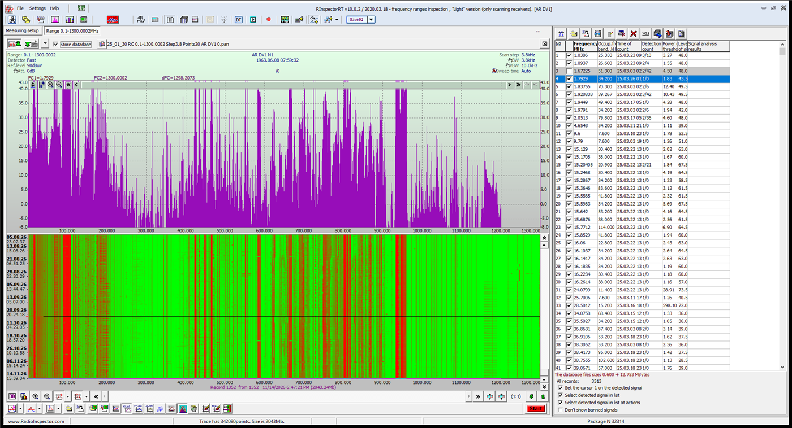

*Главное окно в рабочем состоянии: меню и панель инструментов, левая часть —
спектрограмма и водопад диапазона 0,1–1300 МГц, правая — таблица найденных
сигналов с базой на 3313 записей; в заголовке — метка прибора [AR DV1].*

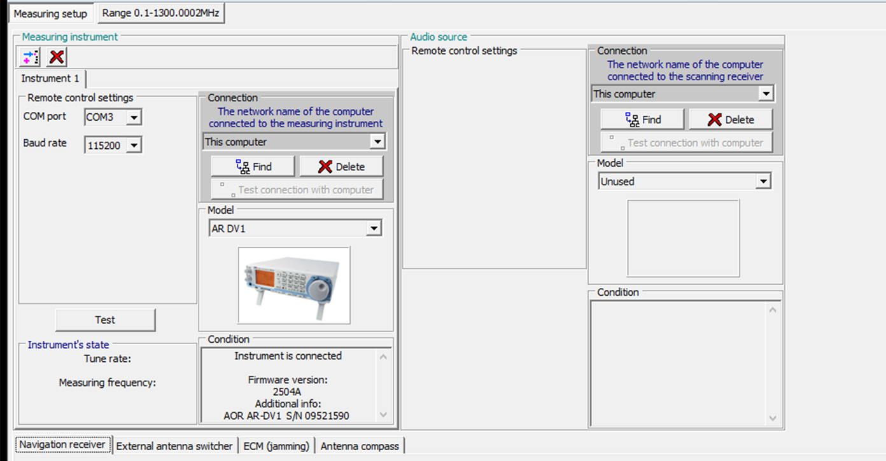

*Группа «Measuring instrument» (прибор, COM-порт, скорость, модель AR DV1,
кнопка Test, состояние приёмника) и группа «Audio source» (источник звука не
задан; наличие RC-Sound подтверждено отдельно в About).*

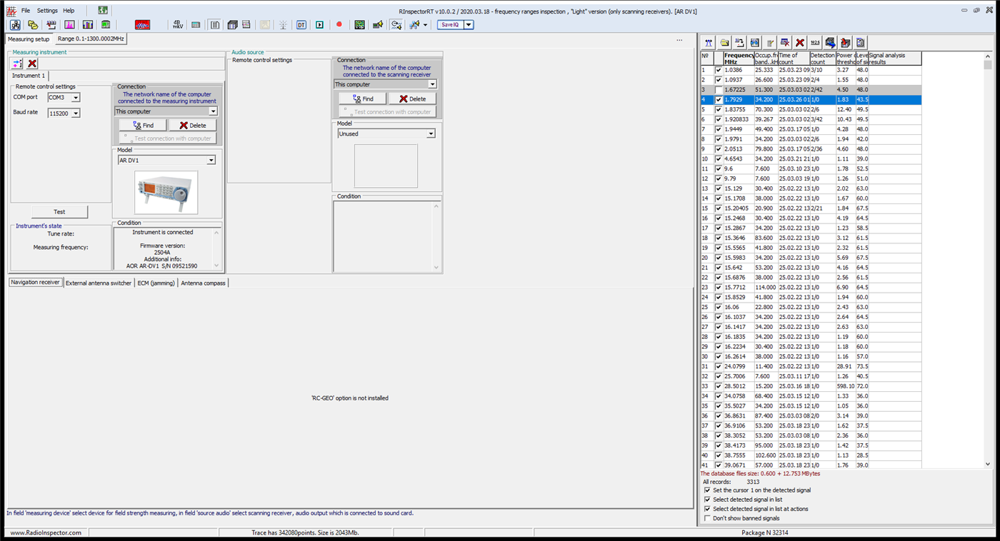

*Вкладка Navigation receiver: опция RC-GEO в сборке не установлена, поэтому
вместо карты выводится соответствующее сообщение.*


*Вкладка External antenna switcher: настройки удалённого управления внешним
коммутатором антенны, модель и состояние устройства.*

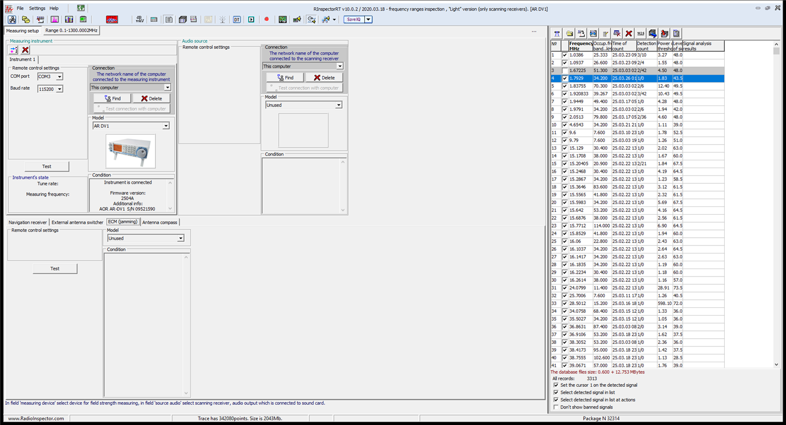

*Вкладка ECM (jamming): параметры работы с аппаратурой радиоэлектронной
борьбы и источник сигнала для контроля.*


*Вкладка Antenna compass: задание азимута и угла места для пеленгования.*

### 12.3. Общие настройки (Common settings)

Девять вкладок окна Common settings показаны на снимках из двух сеансов.

| Вкладка | Снимок |
|---|---|
| Control via network | 46 |
| Traces database | 47 |
| Folders | 48 |
| Detected signals frequencies | 09 |
| Antenna switch | 50 |
| Geoinformation system | 51 |
| Other settings | 52 |
| Sound demodulation options | 53 |
| Remote check computer | 54 |

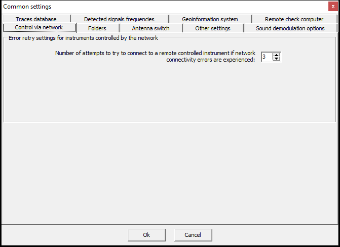

*Число повторных попыток подключения к удалённому прибору при сетевой ошибке: 3.
Порт и параметры TCP-сервера на этом снимке не показаны.*

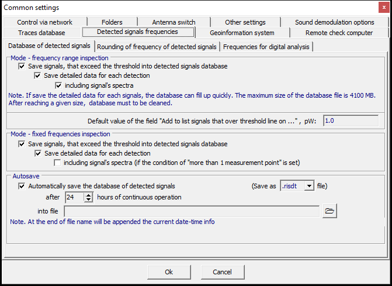

*Хранилище записей панорам: режим удаления (никогда / старше N дней), предел
объёма, ежедневная ротация файла базы.*

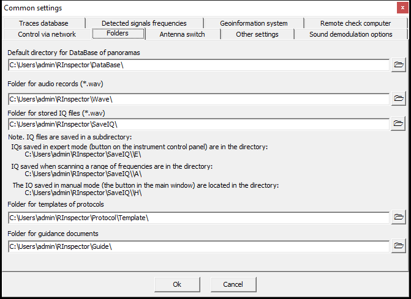

*Рабочие каталоги программы: сохранение IQ, шаблоны протоколов, волновые
файлы, база данных и справка.*


*База найденных сигналов. Снимок показывает формат .risdt, автосохранение и
раздельные настройки сохранения спектров. Файл 49 дублирует снимок 47.*

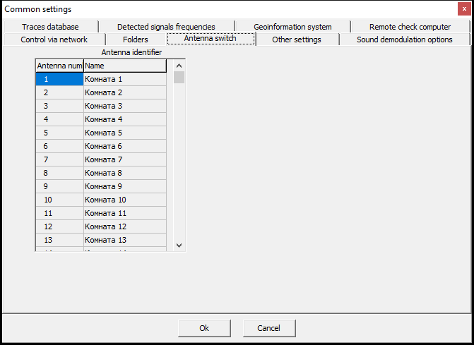

*Настройки внешнего коммутатора антенны и его сопряжения с приёмником.*

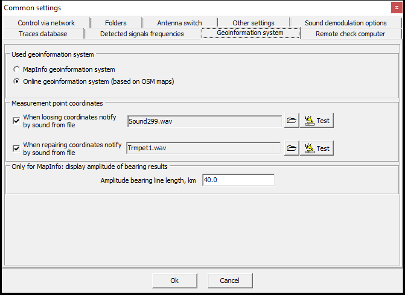

*Геоинформационная привязка: источник карт (MapInfo или онлайн-сервис по
данным OpenStreetMap) и звуковое уведомление о смене координат.*

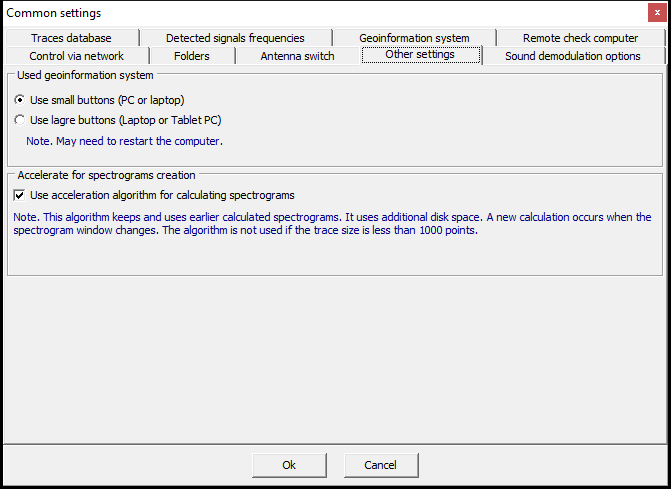

*Прочие параметры: ускорение перерисовки спектрограмм и размер экранных
кнопок.*

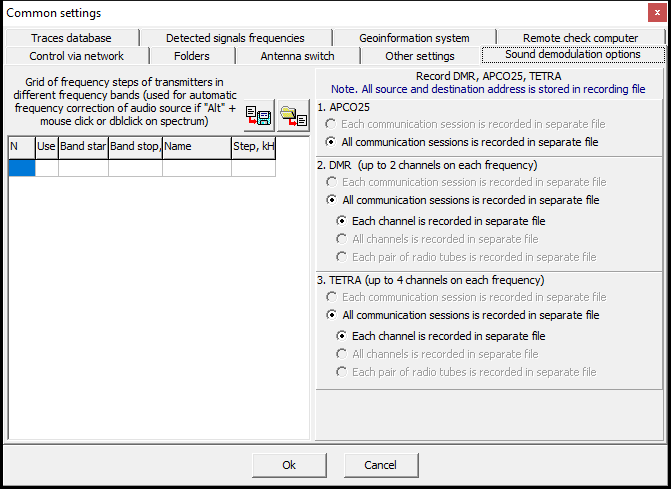

*Параметры записи демодулированного аудиосигнала для цифровых стандартов
APCO25, DMR и TETRA.*

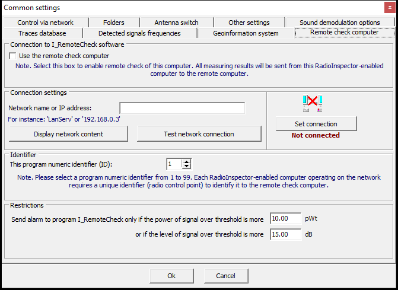

*Проверка удалённого рабочего места: сетевое имя, IP-адрес и идентификатор
проверяемого компьютера.*

### 12.4. Диалоги

| Диалог | Как открывается | Снимок |
|---|---|---|
| Configuration of analysis parameters … — вкладка Actions if signal detected | Settings → Actions if signal over threshold … | 55 |
| то же окно — вкладка Found out signals list | там же, вторая вкладка | 56 |
| Signal's digital processing | Settings → Modify parameters of algorithms | 57 |
| Information: DigitalTest option is not installed | Settings → Analysis of digital communication standards | 58 |
| About | Help → About | 59 |
| Firebird database software is not installed (Display) | Settings → Authorized frequencies database → Display | 60 |
| то же сообщение (Find) | Settings → Authorized frequencies database → Find | 61 |
| Save scan task | нижняя панель, кнопка выгрузки задания | 67 |
| Open measurements results database | нижняя панель, кнопка базы результатов | 68 |
| Load reference trace | нижняя панель, кнопка опорной трассы | 69 |

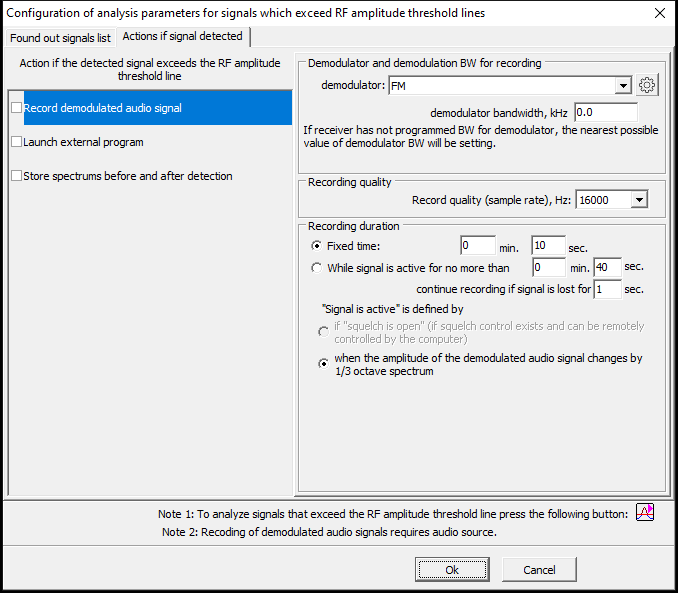

*Параметры реакции на превышение порога: что делать при срабатывании
(записывать демодулированный аудиосигнал, запускать внешнюю программу,
сохранять спектры), демодулятор и полоса, качество и длительность записи,
критерий «сигнал активен». Внизу — две примечания и кнопки Ok / Cancel.*

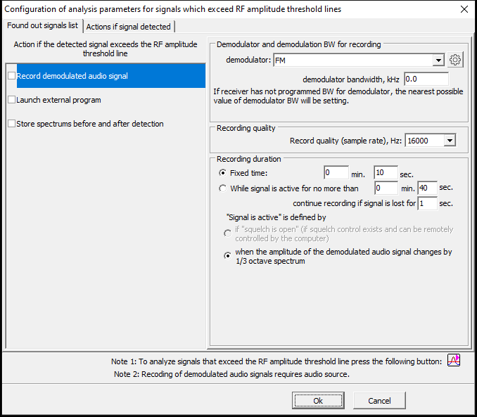

*Вторая вкладка того же окна: правила отбора сигналов в список найденных
(критерий по времени, по мощности над порогом) и параметры выборки.*

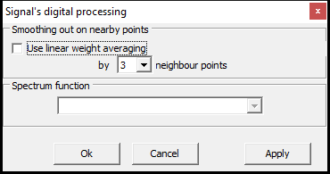

*Параметры алгоритмов цифровой обработки: сглаживание, линейное усреднение
по трём соседним точкам, функция спектра.*

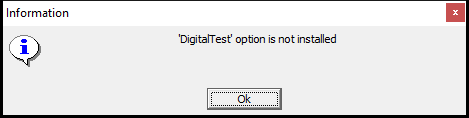

*Модальное информационное окно: опция анализа цифровых стандартов в сборке
не установлена.*

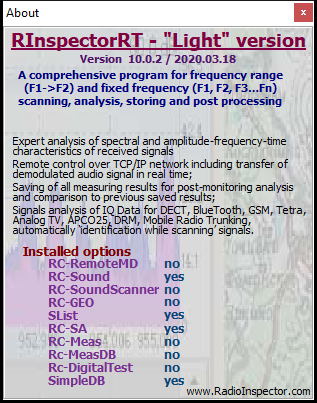

*Диалог About: версия 10.0.2 / 2020.03.18, назначение программы и таблица
Installed options.*


*Просмотр базы разрешённых частот требует СУБД Firebird, которая на машине не
установлена.*

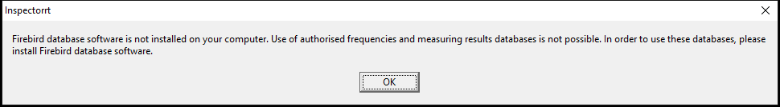

*То же сообщение для поиска по базе разрешённых частот.*

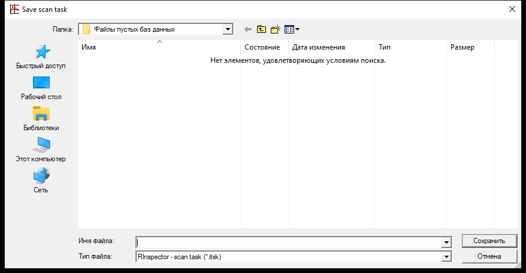

*Стандартный диалог сохранения задания диапазона в файл.*

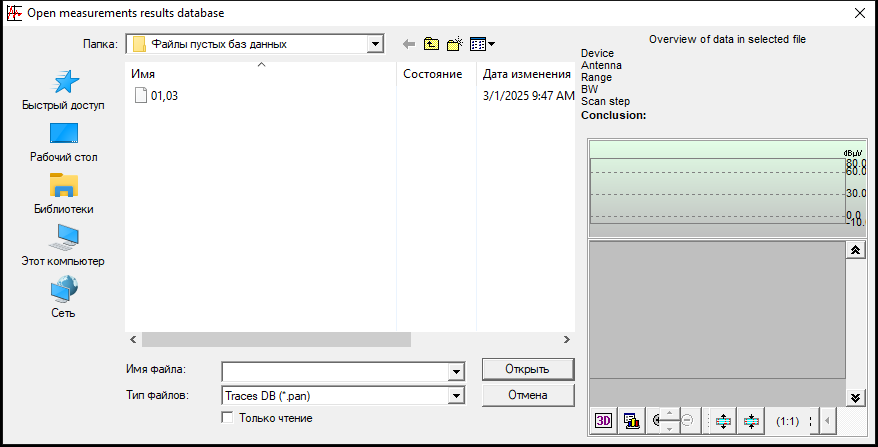

*Диалог открытия базы результатов измерений.*

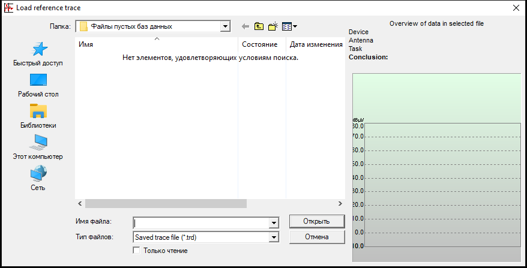

*Диалог загрузки опорной трассы — второго эталона, с которым сравнивается
текущая.*

### 12.5. Меню

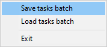

*File: пакетное сохранение и загрузка заданий, выход из программы.*

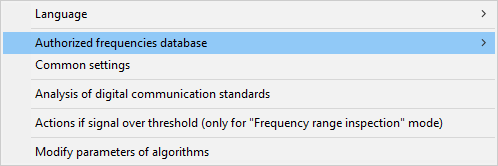

*Settings: язык, база разрешённых частот, общие настройки, анализ цифровых
стандартов, реакция на превышение порога, параметры алгоритмов.*


*Переключение языка интерфейса: English, Russian, Spanish.*

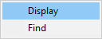

*База разрешённых частот: просмотр (Display) и поиск (Find).*

### 12.6. Контекстные меню

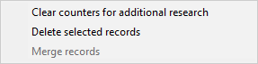

*Сброс счётчиков для дополнительного исследования, удаление выбранных
записей, объединение записей (доступно при выделении).*

Контекстное меню спектограммы (20 пунктов: трассы, маркеры, курсоры, гармоники
курсора, сохранение трассы и картинки в файл, MS Word и MS Excel) показано
ранее на снимке
[39-spectrum-context-menu.png](images/rinspectorrt-light/39-spectrum-context-menu.png).

### 12.7. Окна, присутствующие в программе, но не открывающиеся в наблюдаемой сборке

Перебор окон процесса выявил дополнительные формы, которые в Light-сборке
не вызываются из доступного интерфейса:

| Класс формы | Заголовок | Назначение |
|---|---|---|
| TFOsc | Low-frequency oscilloscope | низкочастотный осциллограф |
| TFSaveSound | Saving audio received on | параметры сохранения принятого аудиосигнала |
| TFActionSignals | Detected signals queue for study | очередь сигналов, взятых на исследование |
| TFACntrlEdit | FACntrlEdit | редактор параметров внешнего коммутатора антенны |
| THintWindow | Level measuring units | всплывающая подсказка о единицах уровня |

Наличие этих форм в бинарном образе показывает, что интерфейс наследует
возможности полной версии RadioInspector (осциллограф, очередь исследуемых
сигналов, сохранение аудио), но в Light-сборке они не задействованы: опция
RC-Sound установлена, однако путь до осциллографа и до формы сохранения
аудиосигнала из наблюдаемого интерфейса недоступен. Для OpenRadioInspector
это ориентир: очередь сигналов на исследование и осциллограф IF-сигнала —
самостоятельные полезные функции, которые стоит закладывать явно.
